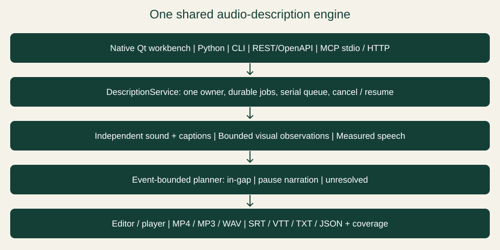

# Describer Workbench

**One audio-description engine for a desktop workbench, Python, CLI, REST/OpenAPI and MCP.**

macOS and Linux are additional native distributions of 0.6.1 under the separate [platform add-on release](https://github.com/scottconverse/Describer-Workbench/releases/tag/v0.6.1-unix.1): Apple Silicon/Intel Mac DMGs and Linux x64 DEB/portable archive. Follow [macOS/Linux installation, source installation and platform limits](docs/UNIX-INSTALL.md). Mac packages have no Apple publisher certificate or notarization. The signed Windows 0.6.1 package below remains unchanged and stays the default stable release.

**Version 0.6.1** fixes whole-chunk metadata validation and retry, visible subscription connection tests and disclosure, settings recovery, model metadata display, workflow instructions, optional-hours VTT import and prompt-preset rename. See [connection setup and verification limits](docs/AI-CONNECTIONS.md) and [0.6.1 acceptance](docs/V061-ACCEPTANCE.md). Windows releases require Scott Converse Azure Trusted Signing; the release verification asset records the executed signing and delivery results. The [0.6.0 record](docs/V060-ACCEPTANCE.md) remains historical evidence.

Open a video, draft descriptions through the selected analysis connection, edit every cue, listen alongside the video, and export subtitles or a narrated audio mix. Version 0.6.1 supports Gemini, Ollama, the existing subscription gateway, native Codex/Claude/Antigravity tools and explicit API profiles. Manual editing, subtitle import and Windows speech work without an AI API key. These are reviewed drafts: correct visual facts, missing events, readable text and timing before final export.

[Windows 0.6.1](https://github.com/scottconverse/Describer-Workbench/releases/tag/v0.6.1) · [Website](https://describer-workbench.sconverse.chatgpt.site) · [User manual](docs/USER-MANUAL.md) · [Architecture](docs/ARCHITECTURE.md) · [Developer guide](docs/DEVELOPER-GUIDE.md) · [Issues](https://github.com/scottconverse/Describer-Workbench/issues)

> AI output is a draft. Review visual facts, character identities, timing and overlap with dialogue. Ollama receives sampled images **without audio**, so it cannot determine dialogue gaps or audible names. The shared engine measures speech/vocal protection independently with a pinned local YAMNet classifier. This reduces timing conflicts; it does not establish visual accuracy or legal compliance.

## Capabilities

| Task | Behavior |
| --- | --- |
| Open media | Local MP4, MKV, MOV, AVI and WebM; All files selector for other supported inputs. Download direct video or YouTube URLs through yt-dlp. |
| Draft descriptions | Gemini video uploads, Ollama vision, subscription gateway/native CLIs or compatible API requests. Whole video, Next 20 seconds or Next 60 seconds. Sequential chunks with character glossary continuity. |
| Choose models | Exact IDs retained per route/profile; catalog metadata where available and manual ID entry. Image test on new routes; Ollama retains its labeled text test. No silent fallback. |
| Edit and save | Start/end/text cue editor, glossary, `.adproject` persistence, SRT/VTT import. |
| Explore scenes | Per-answer Speak/Copy/Add controls;2/5/10/20-second Explore ranges with optional focus/glossary; keyboard exploration of an AI-generated spatial layout. |
| Hear descriptions | Timed cues use measured export-voice audio, Windows by default. Optional active screen-reader output applies to live text/Scene answers. Gain and ducking follow player/speech controls. |
| Export | MP4 with pause extensions, narrated MP3/WAV, SRT, VTT, TXT and project JSON. Coverage sidecars explain in-gap, pause and unresolved events. Windows SAPI, 32-bit SAPI, OneCore or optional OpenAI speech. |
| Developer integration | Same serial, durable engine through Python, CLI, authenticated loopback REST/OpenAPI and MCP stdio/Streamable HTTP. Submit, batch, poll, cancel/resume, page/time-filter results, edit, ask/explore, preview voices and export. |
| Timing | Independently measured speech/vocal protection; event-bounded slots; acceleration capped at 1.15x. Descriptions that cannot fit become explicit pause narration, without deleting genuine repeated events. |
| Customize | Language-specific prompt presets, voice personalities, verbosity, interface language, sounds and diagnostic level. |

## Install and start

1. Download `DescriberWorkbench-0.6.1-windows-x64.zip` from the [release](https://github.com/scottconverse/Describer-Workbench/releases/tag/v0.6.1).
2. Extract the complete ZIP to a writable folder. Open `DescriberWorkbench/DescriberWorkbench.exe`; keep `_internal` beside it. Python, Qt, FFmpeg and FFprobe are bundled.
3. Select **Open video** and choose your video. Open it before importing subtitle cues. Standalone audio is not a documented input workflow.
4. Choose an analysis provider/model and a short range, or add cues manually. Follow the [first-project walkthrough](docs/USER-MANUAL.md#3-your-first-project).
5. Save with **Ctrl+S**, review playback and use **Export** for SRT, text or MP3.

The Windows binary targets 64-bit Windows and has GUI and CLI executables **signed as Scott Converse using Azure Trusted Signing**. Windows 11 was used for local acceptance. Windows speech depends on installed voices. The separate macOS/Linux add-ons use macOS voices or eSpeak NG and native secure credential storage. Ollama, model weights and test media are separate. No formal minimum RAM/GPU requirement is established; hardware needs depend on the local model.

Compare your download with the release's `SHA256SUMS.txt`:

```powershell
Get-FileHash .\DescriberWorkbench-0.6.1-windows-x64.zip -Algorithm SHA256
```

## Does it need an API key?

| Workflow | Key / account | Data sent |
| --- | --- | --- |
| Manual cues, subtitle import, playback, Windows speech/MP3 | No AI key | Local processing |
| Ollama model on this computer | No provider key for the default loopback server | Frames/prompts to local Ollama |
| Ollama cloud / remote server | Access configured in Ollama or the server's optional key | Sampled frames/prompts leave the computer after confirmation |
| Gemini analysis, Ask and Explore | Gemini key and accessible model | Video with audio unless silent upload is selected; confirmation required |
| OpenAI speech export/preview | OpenAI key and accessible speech model | Description text after confirmation |

Version 0.6.1 includes the finite [connection inventory](docs/AI-CONNECTIONS.md). Native tools and the gateway retain their own sign-in; File > Subscription sign-in opens the selected native tool. API-credit routes remain separate from subscriptions. Installing a CLI or listing a model does not prove login, entitlement or vision.

## Ollama quick start

Install and start [Ollama](https://ollama.com/), and separately install a vision model suitable for your hardware. In **Draft with AI**, choose **Ollama → Refresh models**, then select an installed entry marked **vision**. Select a model row or type its exact ID in the separate **Exact analysis model ID** field. **Test connection** checks capability and makes a small text request, not a visual accuracy test. Seek to a scene, choose **Next 20 seconds** or **Next 60 seconds**, then **Start draft** in **Draft with AI**.

Default server root: `http://127.0.0.1:11434`. Settings can change it. Remote servers require HTTPS; do not append `/api` or `/v1`. Configure cloud sign-in in Ollama itself.

### Exact-tag profiles

| Tag | Thinking | Output ceiling | Context | Sampling |
| --- | --- | --- | --- | --- |
| `gemma4:12b` | Off | 32,768 | 65,536 | Native defaults |
| `gemma4:26b` | Off | 32,768 | 65,536 | Native defaults |
| `qwen3.8:27b-q6_K-vision` | Off | 32,768 | 65,536 | Native defaults |

These are exact matches, not guaranteed model registry names. The Qwen vision tag existed on the test machine; a similarly named text-only tag is refused. Aliases/renamed tags do not inherit the profile. Limits are ceilings, not target response lengths. The `deepseek-v4.1-flash:1017...` family requests low effort while still requiring vision capability. Other tags retain the existing adapter behavior. Profiles apply per request and do not change global Ollama configuration.

Ollama receives up to eight timestamped frames per request, 640 pixels wide. At the default two-second interval, analysis uses chunks of at most 16 seconds; a 60-second range normally takes four requests. Ask samples at most eight frames across its scene window. Larger context/output cannot recover missing motion or audio.

## Editing and export

Open media → draft or import cues → correct the glossary → edit facts and timing → listen with the soundtrack → save → export.

Select a description to seek to its start and expand the inline editor. Times accept seconds, `MM:SS` or `HH:MM:SS`. Changing Start shifts End to preserve cue duration; changing End adjusts only End. Valid edits apply as you type; Ctrl+Z undoes. **Add at playhead** creates and selects a three-second cue. **Ctrl+S** saves the project. Analysis and subtitle import replace descriptions after confirmation; range analysis replaces the cue list. Save a separate `.adproject` copy to preserve comparisons.

Version 0.6.1 includes the redesigned native PySide6 interface in source and the Windows portable download.

The engine measures synthesized speech and fits it only within the visual event and independently protected soundtrack. Speed is capped at 1.15x; no-fit descriptions pause the source instead of being discarded or moved to an unrelated scene. Complete MP4 exports freeze the video during those descriptions; MP3/WAV exports insert matching audio pauses. Uncertain events remain unresolved and block a complete narrated export. Explicit `in-gap-only` exports are marked incomplete. Script exports retain all events and a coverage sidecar; a subtitle file alone cannot express pause playback. Audio mixes downmix to stereo.

Draft checks the selected detector and offers explicit install/repair before inference. You can also use **File → Install speech detector**. This explicitly downloads and verifies the pinned Google YAMNet asset. Missing or corrupt assets fail safely; no model guesses dialogue slots.

## Architecture



Python/PySide6 provides the editor; every consumer uses `DescriptionService` and one serial queue. The headless engine owns jobs, checkpoints, independent sound protection, observation, synthesis, placement and export. FFmpeg prepares media and mixes audio. Existing version-1 projects still load; new fields preserve event intervals, coverage and placement. Keys remain outside job/project files. See the [architecture guide](docs/ARCHITECTURE.md) for module responsibilities, request sequences and trust boundaries.

## Privacy, storage and updates

- Settings: `%LOCALAPPDATA%/DescriberWorkbench/settings.json`. Keys use Windows DPAPI for the current account; settings are not a portable key vault.
- Projects: `.adproject` JSON contains an absolute media path, duration, cues, glossary, event/placement metadata, coverage and analysis. It does not embed video or API keys. Keep media separately.
- Durable workspace: `%LOCALAPPDATA%/DescriberWorkbench/engine` (or `DESCRIBER_HOME/engine`) retains job snapshots, checkpoints and narration WAVs for explicit resume. Keep this directory with projects that refer to its audio. No automatic retention/deletion policy is applied. One process owns a workspace; attach other consumers over HTTP.
- Telemetry: no application analytics; Hugging Face/OTEL telemetry defaults and ONNX Runtime telemetry are disabled. HTTP explicitly disables FastAPI tracing, metrics, telemetry logs and auto-export setup. Explicit provider/download requests are separate, documented transmissions.
- Diagnostics: rotated logs beside settings. Configured keys are redacted; paths, text and provider errors can remain. Inspect before sharing.
- Gemini: upload deletion is attempted in `finally`; provider retention applies if cleanup fails. Cancellation cannot undo an upload or charge.
- Ollama: loopback requests go to the configured local server. Cloud/remote use prompts before sending frames and text; Ollama controls further routing.
- Updates: blank feed checks the official latest stable GitHub release; staging requires matching hashes and timestamped Scott Converse signatures on both executables, then rechecks payload hashes before swapping. Rollback folders are retained. Startup checking is opt-in.

See [privacy and recovery](docs/USER-MANUAL.md#12-privacy-storage-and-recovery) for details.

## Run and build from source

Tested with Windows and Python 3.13. Install FFmpeg/FFprobe on PATH or place their executables in `bin/`.

```powershell
git clone https://github.com/scottconverse/Describer-Workbench.git
cd Describer-Workbench
py -3.13 -m venv .venv
.\.venv\Scripts\python.exe -m pip install -e ".[desktop,http,mcp,dev]"
.\.venv\Scripts\python.exe run.py
# Build the portable folder:
.\build.ps1
```

The build script installs the desktop, local-model and developer transport extras plus PyInstaller 6.22.3, copies missing media tools from PATH (including Scoop shim targets), and builds `dist/DescriberWorkbench/`. The folder includes `DescriberCLI.exe` for the same CLI, HTTP owner and MCP tools without a separate Python install. It uses `py -3` when creating a missing environment: explicitly create `.venv` with Python 3.13 for the tested interpreter. Your source build is a new artifact and does not inherit the published executable's hash or acceptance evidence.

## Verification

For 0.6.1, see the [release acceptance record](docs/V061-ACCEPTANCE.md) and the release verification asset for source identity, signed artifact hashes, CI results and remaining limits. The [0.5.1 acceptance record](docs/V051-ACCEPTANCE.md) preserves earlier results. Historical 0.4.2 evidence below applies only to that release. The new protocol tests initialize real MCP clients over stdio and HTTP; media tests check actual FFmpeg output. No percentage visual-accuracy claim is made.

```powershell
.\.venv\Scripts\python.exe -m pytest -q
# Optional media acceptance: opens a window, synthesizes speech and writes receipts:
.\.venv\Scripts\python.exe tests/local_acceptance.py "C:\media\sample.mp4" "C:\receipts\workbench"
```

| Evidence | Established scope |
| --- | --- |
| 0.4.2 suite | All 28 tests passed, including exact-tag picker/request settings and regressions. |
| Actual rebuilt GUI | Bunny 1:02–2:02, clean starting glossaries, Gemma 26B and Qwen Q6: four completed requests each, 32K/64K/off settings, confirmed 64K runtime, no truncation/thinking output. |
| Saved results | 29 Gemma cues and 25 Qwen cues matched normalized responses. Cue counts are not accuracy scores. |
| Artifact | All 13 frozen app modules matched source; installed launch/playback accepted. Published ZIP and downloaded copies verified by SHA256. |
| Earlier media samples | Nine sampled video exports, 40 subtitle files and three audio layouts passed; not full-film coverage. |

The [v0.6.1 release](https://github.com/scottconverse/Describer-Workbench/releases/tag/v0.6.1) includes sanitized verification JSON and checksums. The table above is historical 0.4.2 evidence; the [0.6.1 acceptance record](docs/V061-ACCEPTANCE.md) covers the current release. Raw receipts stay local because they contain frames/machine paths. Native Codex/Claude/Antigravity and gateway Codex/Claude/Gemini have bounded image-backed description/Scene evidence. Gateway Gemini reported a different canonical model from its requested high alias; native Codex/Antigravity did not report model identity. Separate keyed Gemini/OpenAI/Anthropic and LM Studio/llama.cpp services retain their live-testing limits. NVDA/JAWS end-to-end use, native-speaker translation review, public YouTube extractor compatibility and full-film AD quality remain unverified. Windows GitHub CI runs the suite, lint, documentation rendering and Python package build. Its media tests use generated fixtures; the separate native acceptance record covers the actual vision/speech pipeline and portable executables. [AUDIT.md](AUDIT.md) records original parity work and historical results; read them in their version context.

## Documentation and development

- [User manual](docs/USER-MANUAL.md): nontechnical walkthrough, reference, troubleshooting and technical user section.
- [Architecture](docs/ARCHITECTURE.md): components, sequences and data boundaries.
- [Developer guide](docs/DEVELOPER-GUIDE.md): install extras, Python/CLI/REST/MCP contracts, authentication, jobs and export modes.
- [Public documentation audit](docs/PUBLIC-AUDIT.md): corrections, code tracing, download checks and verification limits.
- [Parity](PARITY.md), [audit](AUDIT.md) and [third-party notices](THIRD-PARTY-NOTICES.md).

For an issue include the app/Windows version, exact provider/model, reproduction steps, expected result and redacted logs. Never post keys, private video, complete settings or unsanitized projects. Describe the scope actually tested.

The landing page is in `website/`. The [GitHub Pages site](https://scottconverse.github.io/Describer-Workbench/) mirrors the landing page, manuals and diagrams through `.github/workflows/pages.yml` on documentation changes to `main`. The existing [website](https://describer-workbench.sconverse.chatgpt.site) remains available and is the canonical address in generated metadata. Both use the same renderer and relative HTML navigation; no analytics are added.

Render the manual/site with a documentation-only dependency:

```powershell
.\.venv\Scripts\python.exe -m pip install -r docs/requirements.txt
.\.venv\Scripts\python.exe tools/build_site.py --output "C:\work\workbench-site"
```

The output includes the landing page, HTML guides, architecture drawings and downloadable Markdown. Downloaded Markdown uses absolute web links so navigation survives saving it outside the repository. Hosting is separate from the desktop app; docs publication does not rebuild the executable. The immutable 0.4.2 ZIPs retain their historical documentation. The immutable 0.5.1 portable contains the guides as packaged at release time; subsequent corrections are maintained in this README and the online/downloadable manuals. The 0.5.2 ZIP was corrected to include Scott Converse signatures and refreshed documentation; its release verification asset records the correction. Documentation updates can refresh packaged guides and checksums while preserving signed executable bytes.

## Provenance and licensing

Independently written Python source reconstructs a documented Omni Describer workflow through supplied documentation and static analysis. This is **not recovered original source** and implies no original-author endorsement. Original executables, recovered bytecode and branding are not distributed. Attributed translations retain their original terms in `third-party-licenses/Omni-Describer.txt`.

New Workbench code is licensed under **Apache-2.0**, with the no-warranty terms in [LICENSE](LICENSE). See [NOTICE](NOTICE) for attribution. Third-party components retain their own terms, including Qt/PySide, FFmpeg and original translation restrictions. Consult [THIRD-PARTY-NOTICES.md](THIRD-PARTY-NOTICES.md) and retained texts before redistribution; the original app's terms do not license all Workbench code.
