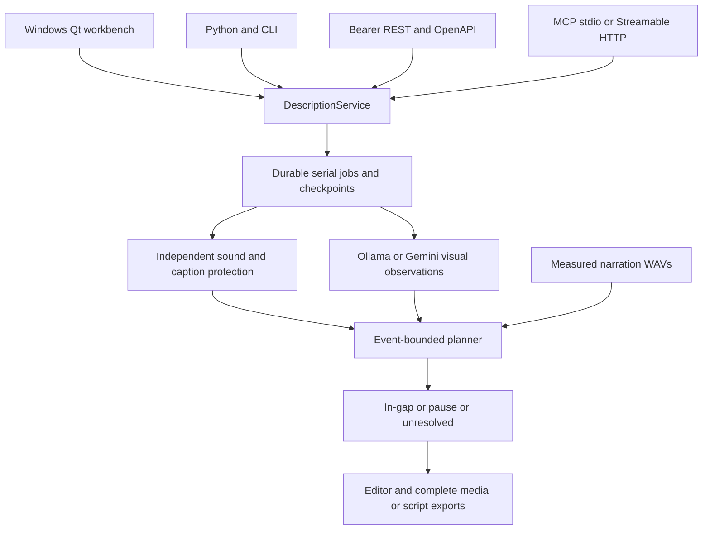
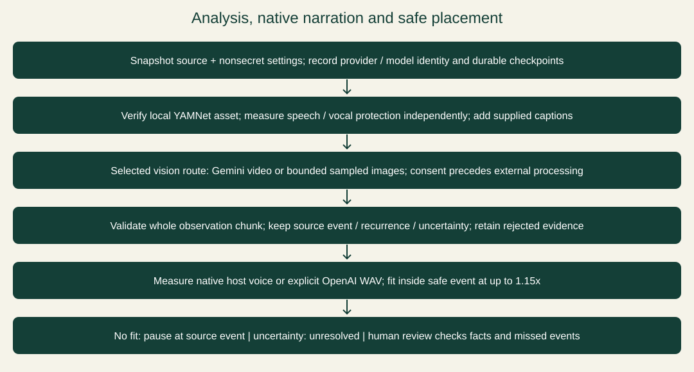
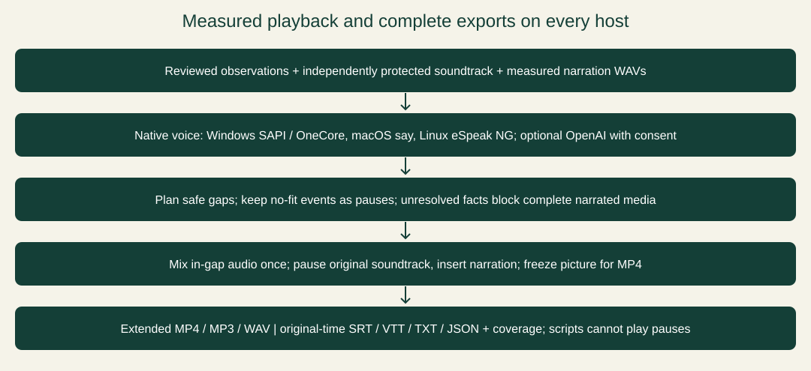

# Architecture and implementation guide

Describer Workbench **0.5.2**. Shared engine and native Windows portable release. See [release acceptance](V052-ACCEPTANCE.md) for verification scope and limits.

[User manual](USER-MANUAL.md) · [Developer guide](DEVELOPER-GUIDE.md) · [Repository](https://github.com/scottconverse/Describer-Workbench)

## System overview

The engine lives in Describer-Workbench. CivicCast remains a separate consumer; no release-candidate or live station data is part of this workspace. Desktop, Python, CLI, REST and MCP all call `DescriptionService`. A workspace has one process owner, an exclusive file lock and a serial job queue. Additional processes attach over HTTP rather than opening the same workspace. The headless imports do not require Qt. Native speech currently requires Windows; other speech adapters retain their platform/provider requirements.

## Source map

| Module | Responsibility |
| --- | --- |
| `engine/service.py` | Workspace ownership, persistent jobs, serial queue, batch, cancel/resume, revision edits, result reads and adapter-facing operations. |
| `engine/core.py` | Source/settings identity, stage checkpoints, independent protection, observation and measured narration planning. |
| `engine/sound.py`, `assets.py` | Bounded YAMNet speech/vocal classification, pinned explicit asset provisioning and integrity checks; ONNX telemetry disabled. |
| `engine/planning.py` | Safe-gap intersection with original event interval, collision checks, acceleration ceiling and no-fit dispositions. |
| `engine/exporting.py` | Complete MP4/MP3/WAV, pause insertions, script formats and coverage receipts. |
| `adapters/http.py`, `mcp.py`, `remote.py`, `cli.py` | REST/OpenAPI, 17 MCP tools, HTTP proxy and scriptable CLI. |
| `app.py`, `desktop.py`, `model_picker.py` | Qt editing/player, durable-engine consumers, explicit cloud consent and model selection. |
| `services.py`, `models.py` | Media preparation, provider requests, native/cloud speech, DPAPI settings and audio mixing. Low-level adapters do not own an alternate planner. |
| `project.py` | Version-1 project compatibility, cue validation, event metadata and structural normalization. |
| `windows_speech.py`, `playback_speech.py` | Windows voice hosts, legacy unplanned playback and optional reader routing. |
| `compatibility.py`, `catalogue.py`, `i18n.py` | Read-only original-data import, presets and translation application. |
| `diagnostics.py`, `updates.py` | Redacted rotating logs and separately authorized update staging/rollback. |
| `pyproject.toml`, `DescriberWorkbench.spec`, `build.ps1` | Headless/optional packaging and Windows portable build. |
| `docs`, `website`, `tools/build_site.py` | Static documentation, with no inference or analytics service. |

## Analysis lifecycle

Submission snapshots the project and non-secret settings before returning a job handle. Keys are kept in process memory, not persisted. A worker measures the source duration and hashes it, records implementation/model/settings identity, then measures speech/vocal intervals independently of vision. Optional captions add conservative protected spans. If the sound asset is missing or corrupt, the job fails before expensive analysis. There is no model-guessed-gap fallback.

The selected provider then returns bounded visual observations. Ollama sees up to eight timestamped 640px frames per request and no audio. At a two-second frame interval, the maximum chunk is16 seconds, including when ordinary chunking is disabled. Gemini receives video/audio unless silent upload is selected. Glossary continuity is preserved across chunks. Valid overlaps retain their event times. Only identical same-event/time/text rows are deduplicated; recurrent speech/action is retained.

Each observation carries an event interval, kind, visible evidence and optional uncertainty. Synthesis produces a measured WAV. The planner finds a free slot inside the event interval, outside independently protected audio and other descriptions. It tries ordinary speed then bounded acceleration up to1.15x. No fit means pause narration at the original event, not arbitrary relocation or deletion. Uncertainty means unresolved rather than invented certainty. Coverage records every returned observation's disposition; it cannot prove that the vision model observed all essential facts.

## Jobs, cancellation and resume

Job status/input/result JSON, provider stage outputs and narration WAVs remain in the selected workspace. Process exit marks formerly active work interrupted on the next owner startup. Resume is explicit and checks source, settings, provider/model and implementation identity. Cached audio is hashed before reuse. A changed candidate requires a new job rather than silently reusing incompatible outputs. A failed/cancelled job can resume after its worker reaches a terminal state. Queued cancellation does not run the job.

Cancellation is cooperative between chunks, inference stream events and subprocess polling; an idle provider read may take up to its timeout. It cannot undo uploads or charges. One queue prevents competing local models/speech jobs within a workspace; independently configured workspaces remain independent. There is no distributed scheduler or automatic retention policy. API keys must be supplied again after an owner restart.

## Speech and export pipeline

In-gap playback uses measured WAVs at the chosen speed and ducks the soundtrack. Pause-aware desktop playback stops the source and its audio, speaks the pause cue, then resumes. Seeking cancels current narration and resets pending pause handling. Late entry into a safe slot uses pause narration rather than overrunning it. Resume is deferred until the media-status callback unwinds. Unplanned old-project cues retain legacy speech behavior until replanned. Edited cues lose their stale plan.

Complete media exports first create an in-gap narrated bed. Pause events split that bed at original event times and insert narration; MP4 freezes the picture during each insertion. Original audio is paused, not obscured by the inserted voice. Audio is stereo44.1kHz; surround layout is not preserved. Unresolved observations block complete narrated export. Explicit `in-gap-only` export excludes pauses and is marked incomplete in its coverage receipt. Script exports contain all observations and coverage, but SRT/VTT cannot implement video pauses by themselves. The source file cannot be overwritten. Outputs are staged before publication to the requested destination.

## Developer transports and trust boundaries

| Interface | Contract |
| --- | --- |
| Python | Shared `DescriptionService`; no Qt import required. |
| CLI | JSON stdout; synchronous local commands or durable handles through an existing HTTP owner. |
| REST/OpenAPI | Loopback-only default, bearer authentication, Host/Origin checks, async job handles, result paging/time ranges and owned artifact download. |
| MCP stdio | Dedicated workspace owner or proxy to existing HTTP owner;17 tools for the full public engine surface. |
| MCP Streamable HTTP | Same owner/queue/job IDs, mounted at `/mcp/`, same bearer boundary. Legacy HTTP+SSE is not implemented. |

The token grants access to the Windows user's readable media paths and configured providers. This is a trusted developer service, not a public multi-tenant upload endpoint. A public deployment requires a separate TLS/auth/egress and tenancy design. Do not expose the loopback process directly. No OAuth/account system is added.

Settings keys use current-user Windows DPAPI. Projects include absolute source paths, cues, coverage and analysis; planned cues reference workspace audio files. Back up the source, project and workspace together. Logs/status can contain file paths and error text. Provider transmissions occur only on explicit operations with remote allowance/GUI consent; opening a file makes no provider request. Asset provisioning is explicit and verifies the pinned hash.

No application analytics is configured. ONNX telemetry is disabled; Hugging Face/OTEL telemetry-off defaults are set before optional adapters load. FastAPI tracing, metrics, telemetry logs and automatic exporter setup are explicitly disabled. These controls do not claim to change a separately operated provider/server's own behavior.

## Provider profiles

Exact tags `gemma4:12b`, `gemma4:26b` and `qwen3.8:27b-q6_K-vision` keep the existing32,768 output/65,536 context and thinking-off profiles. DeepSeek1017 keeps low effort; other tags retain prior defaults. These are request ceilings, not registry or performance guarantees. No provider/model fallback or global model-setting change is made. Remote Ollama requires HTTPS and redirects are refused. The adapter validates vision capability and bounded JSON responses. Gemini/OpenAI remain optional cloud paths requiring explicit access/consent.

## Build and deployment identity

Hatch builds a small headless wheel with optional desktop, local-classifier, HTTP, MCP, Gemini and download extras. The Windows PyInstaller folder includes the Qt desktop, `DescriberCLI.exe` and developer transports, sharing one module archive. FFmpeg/FFprobe are separate binaries under retained third-party terms. The pinned YAMNet detector is explicitly provisioned; large vision weights, credentials and user videos are not bundled.

The v0.5.2 tag identifies the first-use and recovery release source. Its GUI and CLI executables are signed as Scott Converse using Azure Trusted Signing with Microsoft timestamps. The initial unsigned 0.5.2 ZIP was replaced with the signed files; the release verification asset records build source, signing provenance and post-signing hashes. Later documentation and test-only changes do not rebuild the signed executables. Earlier version releases retain their historical evidence. The static website renderer produces manual, architecture and developer pages with downloadable Markdown; it does not process videos or host model credentials. See [release acceptance](V052-ACCEPTANCE.md) for observed results and limits.

## Evidence limits

Automated checks cover structural behavior, real MCP initialization, HTTP boundaries, old-project compatibility, checkpoint reuse and real FFmpeg pause exports. The three native Blender samples exercise the real local vision, classifier and speech pipeline. Neither cue counts nor successful playback establish a percentage visual-accuracy score, WCAG compliance or complete essential-information coverage. Live keyed Gemini/OpenAI/cloud, Linux/macOS native speech, NVDA/JAWS and full-film semantic quality remain outside verified acceptance. Historical audits apply only to their recorded candidates.

## Industry desktop presentation

`describer/desktop.py` supplies native Qt widgets, QSS, timeline painting, focusable cue targets, scene layout and dialogs to `app.Window`. `Window` retains worker ownership, cloud confirmations and service calls. Cue changes use a Qt undo stack; invalid intermediate edits never enter the project. Thumbnail generation uses an owned, bounded FFmpeg QProcess and stops on close. Barlow fonts and Lucide icons are bundled locally with licenses. Export voice discovery uses a cancellable Qt worker and the existing speech-engine voice identifiers; dialog cancellation preserves settings. No browser runtime is embedded.

The timeline maintains a bounded visible time range with pointer-anchored Ctrl+wheel zoom, scrollbar panning, and playhead/selection following. Eight thumbnails are sampled inside the visible time range by a debounced FFmpeg subprocess; stale viewport results are discarded. Cue row delegates render human status tags and tinted selection; model, format and Settings lists use the same tint/edge selection policy.

The 0.5.2 recovery controls keep this architecture: desktop narration repair submits `prepare` to the existing serial service and uses `core.plan_export`; desktop resume reuses saved jobs and checkpoint identity. Damaged records are isolated without deletion. Both submission and resume apply operation-specific consent. GUI preflight checks run in workers, while final consent and continuation run on the GUI thread. Voice discovery owners remain registered until thread completion, including after dialog closure.
