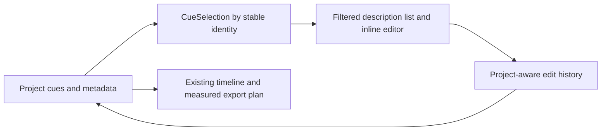
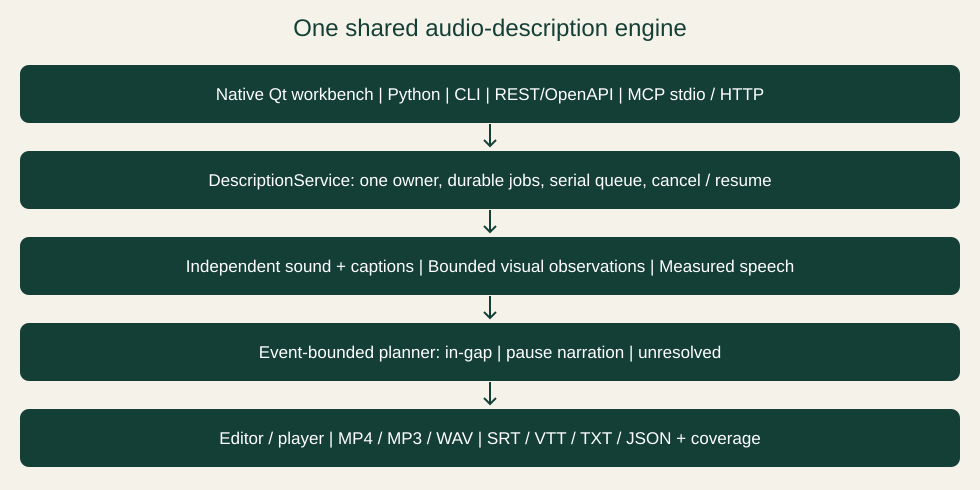
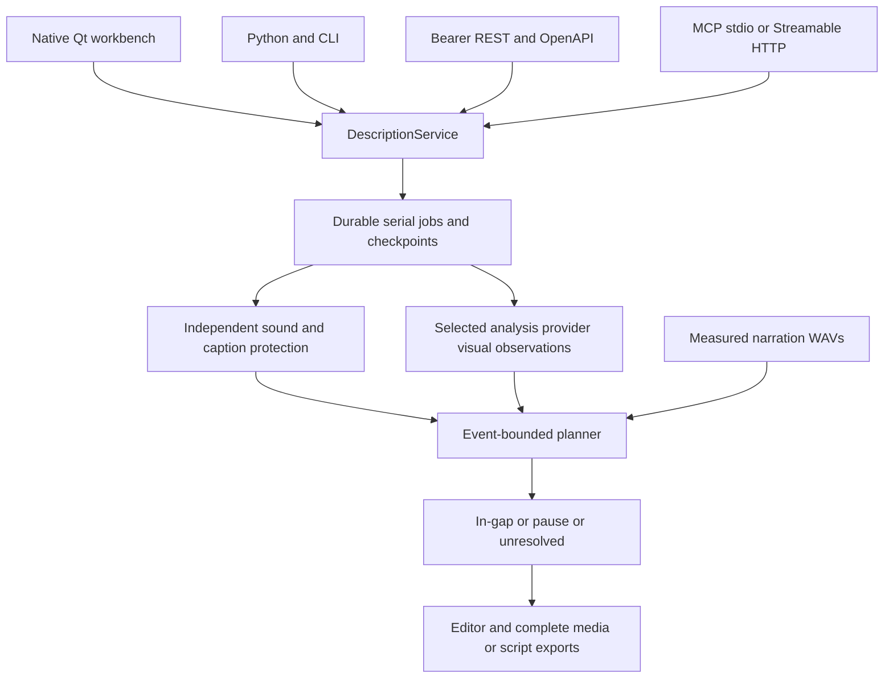
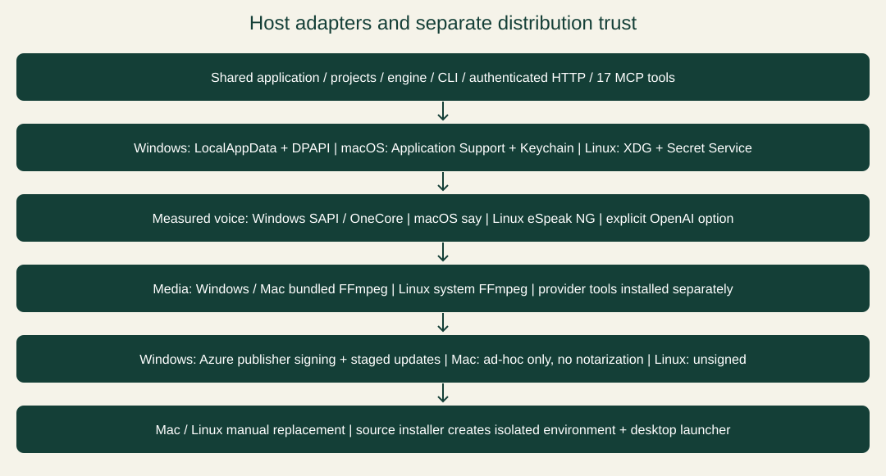

# Architecture and implementation guide

Describer Workbench **0.8.3** · documentation updated November 11, 2026. Shared engine and native desktop workbench for Windows, macOS and Linux. The earlier signed0.5.2 package has its own [historical acceptance record](V052-ACCEPTANCE.md).

The [macOS/Linux distributions](UNIX-INSTALL.md) share the 0.8.3 release with Windows. `platforms.py` chooses host data folders, narration choices and explicit macOS Keychain/Linux Secret Service storage; settings retain only opaque keyring references, with no plaintext fallback. `unix_speech.py` synthesizes through macOS `say` or eSpeak NG into measured WAVs. `DescriberUnix.spec` and Unix install/package helpers are separate from the unchanged Windows build spec. Unix updates are manual; they do not enter Windows Authenticode staging. Existing providers, consent and native CLI authentication ownership remain shared.

Since 0.7.0: [AI connections](AI-CONNECTIONS.md) adds gateway/native subscription and explicit API adapters behind the same service, with no automatic model fallback. Native/gateway routes send up to eight sampled timestamped images without audio. Timed narration retains independently measured WAVs and safe placement; the live-text reader preference does not change that scheduling. Cues record their synthesis volume so live gain and export gain can account for it; older unknown levels require repair. Earlier 0.5.2 packages retain their historical behavior.

The service centralizes provider validation and consent before queueing or resuming. Native tools retain their own authentication and receive an explicit environment allowlist. A shared sampler records actual decoded frame timestamps. Incomplete Gemini responses are durable review artifacts, never completed projects; blocked responses are not recovered. Authored timing, observed event provenance and accepted shortened narration remain separate fields. Structured pipeline/usage records reach both durable jobs and desktop status. Model perception still needs human correction: the accepted reviewed-draft workflow documents remaining factual errors and omissions rather than treating placement coverage as semantic validation.

[User manual](USER-MANUAL.md) · [Developer guide](DEVELOPER-GUIDE.md) · [Repository](https://github.com/scottconverse/Describer-Workbench)

## System overview

Since 0.7.0, a preservation step sits between completed desktop
analysis and the editable project. `drafting.DraftProposal` compares stable cue
IDs and both event/authored intervals, retains boundary-crossing descriptions,
requires explicit conflict replacement and glossary approval, and rejects stale
project fingerprints. One desktop undo transaction carries cues, human review
history, coverage, analysis and glossary together. Accepted partial-job placement
is invalidated before combined narration is re-planned. Headless proposal helpers
do not import Qt. Since 0.7.0 the app reads old project format 1 and save format 2 so an
older application cannot silently discard new identity/review fields on re-save.
These changes were added in 0.7.0.

Typing uses a single-cue command and coverage-row update, retaining
existing list/timeline widgets. Structural/timing edits keep full transactions.
Native list accessibility and timeline names share semantic cue metadata;
custom-painted cue focus is explicit and normal list focus painting is retained.

Editor ownership is explicit: `editor_selection.CueSelection` holds
stable cue identity, while `editor_history` owns structural, typing and glossary
undo commands plus keyboard routing. The hidden compatibility table is removed;
list filtering and time-based sorting project the same selection into visible
widgets. Commands retain the existing project/coverage/review transactions.
Routine Qt tests use the offscreen backend and do not claim reader acceptance.

The engine lives in Describer-Workbench. CivicCast remains a separate consumer; no release-candidate or live station data is part of this workspace. Desktop, Python, CLI, REST and MCP all call `DescriptionService`. A workspace has one process owner, an exclusive file lock and a serial job queue. Additional processes attach over HTTP rather than opening the same workspace. The headless imports do not require Qt. Native speech uses Windows SAPI/OneCore, macOS voices or Linux eSpeak NG; OpenAI speech retains its explicit remote consent and credential requirements.

## Platform adapters and distribution boundaries

| Concern | Windows | macOS 15+ | Linux x86-64 |
| --- | --- | --- | --- |
| Native desktop | PySide6, portable ZIP | PySide6, arm64/x64 `.app` in DMG | PySide6, DEB or portable tar |
| Measured narration | SAPI / 32-bit SAPI / OneCore | `say` to audio, FFmpeg to WAV | eSpeak NG to measured WAV |
| Live-text fallback | Qt system speech | Qt system speech | Qt system speech, dependent on available speech plugin/session |
| Settings folder | `%LOCALAPPDATA%/DescriberWorkbench` | `~/Library/Application Support/DescriberWorkbench` | `${XDG_DATA_HOME:-~/.local/share}/DescriberWorkbench` |
| API-secret persistence | Current-user DPAPI | Keychain reference | Secret Service reference |
| Media tools | Bundled FFmpeg/FFprobe | Bundled architecture-matched FFmpeg/FFprobe; GPL/LGPL source/notices | System FFmpeg/FFprobe |
| Updates | Hash + timestamped Scott Converse signature gate, staged swap/rollback | Download and manual replacement | Download and manual package/archive installation |
| Publisher signing | Azure Trusted Signing, Scott Converse | None; ad-hoc integrity only, no notarization | None |

`platforms.data_directory()` owns settings/log locations. The default durable engine is below that folder; `DESCRIBER_HOME` redirects the engine/assets workspace, not the settings file. `platforms.narration_engines()` restricts choices to native host engines plus optional OpenAI. Native subscription tools retain their own authentication; keyring references do not move that authentication or make copied Windows keys usable on Unix. Linux frozen subprocesses restore the original library environment before invoking system media/speech tools.

The repository installer creates an isolated per-user environment and host launcher. Native package code is shared, while packaging and update trust are separate. A docs-only refresh changes guide/package hashes and may reseal the Mac resource envelope, without changing the accepted app logic or claiming new publisher signing. Exact application and documentation source identities are recorded separately.

## Source map

| Module | Responsibility |
| --- | --- |
| `engine/service.py` | Workspace ownership, persistent jobs, serial queue, batch, cancel/resume, revision edits, result reads and adapter-facing operations. |
| `engine/core.py` | Source/settings identity, stage checkpoints, independent protection, observation and measured narration planning. |
| `engine/sound.py`, `assets.py` | Bounded YAMNet speech/vocal classification, pinned explicit asset provisioning and integrity checks; ONNX telemetry disabled. |
| `engine/planning.py` | Safe-gap intersection with original event interval, collision checks, acceleration ceiling and no-fit dispositions. |
| `engine/exporting.py` | Complete MP4/MP3/WAV, pause insertions, script formats and coverage receipts. |
| `adapters/http.py`, `mcp.py`, `remote.py`, `cli.py` | REST/OpenAPI, 17 MCP tools, HTTP proxy and scriptable CLI. |
| `app.py`, `desktop.py`, `model_picker.py` | Qt editing/player, durable-engine consumers, explicit cloud consent and model selection. |
| `services.py`, `models.py` | Media preparation, provider requests, native/cloud speech, host-protected settings and audio mixing. Low-level adapters do not own an alternate planner. |
| `providers.py`, `subscriptions.py`, `frames.py` | Validated provider/model selection, gateway/native/API transports, restricted child environments and actual source-time frame sampling. |
| `engine/progress.py`, `shortening.py` | Durable stage/usage reporting and conservative measured lead-in shortening. |
| `project.py` | Version-1 project compatibility, cue validation, event metadata and structural normalization. |
| `platforms.py`, `unix_speech.py` | Host folders, native engine choices, Keychain/Secret Service and measured macOS/eSpeak audio. |
| `windows_speech.py`, `playback_speech.py` | Windows voice hosts, legacy unplanned playback and optional reader routing. |
| `compatibility.py`, `catalogue.py`, `i18n.py` | Read-only original-data import, presets and translation application. |
| `diagnostics.py`, `updates.py` | Redacted rotating logs and Windows signed update staging/rollback and Unix manual-download routing. |
| `pyproject.toml`, `DescriberWorkbench.spec`, `build.ps1` | Headless/optional packaging and Windows portable build. |
| `DescriberUnix.spec`, `tools/install_unix.py`, `tools/package_unix.py`, `tools/build_unix_media.py` | Independent Unix freezing, per-user source launcher, native packages and pinned Mac media build/source retention. |
| `docs`, `website`, `tools/build_site.py` | Static documentation, with no inference or analytics service. |

## Analysis lifecycle

Submission snapshots the project and non-secret settings before returning a job handle. Keys are kept in process memory, not persisted. A worker measures the source duration and hashes it, records implementation/model/settings identity, then measures speech/vocal intervals independently of vision. Optional captions add conservative protected spans. If the sound asset is missing or corrupt, the job fails before expensive analysis. There is no model-guessed-gap fallback.

The selected provider then returns bounded visual observations. Ollama sees up to eight timestamped 640px frames per request and no audio. At a two-second frame interval, the maximum chunk is16 seconds, including when ordinary chunking is disabled. Gemini receives video/audio unless silent upload is selected. Glossary continuity is preserved across chunks. Valid overlaps retain their event times. Only identical same-event/time/text rows are deduplicated; recurrent speech/action is retained.

Each observation carries an event interval, kind, visible evidence and optional uncertainty. Synthesis produces a measured WAV. The planner finds a free slot inside the event interval, outside independently protected audio and other descriptions. It tries ordinary speed then bounded acceleration up to1.15x. No fit means pause narration at the original event, not arbitrary relocation or deletion. Uncertainty means unresolved rather than invented certainty. Coverage records every returned observation's disposition; it cannot prove that the vision model observed all essential facts.

## Jobs, cancellation and resume

Job status/input/result JSON, provider stage outputs and narration WAVs remain in the selected workspace. Process exit marks formerly active work interrupted on the next owner startup. Resume is explicit and checks source, settings, provider/model and implementation identity. Cached audio is hashed before reuse. A changed candidate requires a new job rather than silently reusing incompatible outputs. A failed/cancelled job can resume after its worker reaches a terminal state. Queued cancellation does not run the job.

Cancellation is cooperative between chunks, inference stream events and subprocess polling; an idle provider read may take up to its timeout. It cannot undo uploads or charges. One queue prevents competing local models/speech jobs within a workspace; independently configured workspaces remain independent. There is no distributed scheduler or automatic retention policy. API keys must be supplied again after an owner restart.

## Speech and export pipeline

In-gap playback uses measured WAVs at the chosen speed and ducks the soundtrack. Pause-aware desktop playback stops the source and its audio, speaks the pause cue, then resumes. Seeking cancels current narration and resets pending pause handling. Late entry into a safe slot uses pause narration rather than overrunning it. Resume is deferred until the media-status callback unwinds. Unplanned old-project cues retain legacy speech behavior until replanned. Edited cues lose their stale plan.

Complete media exports first create an in-gap narrated bed. Pause events split that bed at original event times and insert narration; MP4 freezes the picture during each insertion. Original audio is paused, not obscured by the inserted voice. Audio is stereo44.1kHz; surround layout is not preserved. Unresolved observations block complete narrated export. Explicit `in-gap-only` export excludes pauses and is marked incomplete in its coverage receipt. Script exports contain all observations and coverage, but SRT/VTT cannot implement video pauses by themselves. The source file cannot be overwritten. Outputs are staged before publication to the requested destination.

## Developer transports and trust boundaries

| Interface | Contract |
| --- | --- |
| Python | Shared `DescriptionService`; no Qt import required. |
| CLI | JSON stdout; synchronous local commands or durable handles through an existing HTTP owner. |
| REST/OpenAPI | Loopback-only default, bearer authentication, Host/Origin checks, async job handles, result paging/time ranges and owned artifact download. |
| MCP stdio | Dedicated workspace owner or proxy to existing HTTP owner;17 tools for the full public engine surface. |
| MCP Streamable HTTP | Same owner/queue/job IDs, mounted at `/mcp/`, same bearer boundary. Legacy HTTP+SSE is not implemented. |

The token grants access to the running user's readable media paths and configured providers. This is a trusted developer service, not a public multi-tenant upload endpoint. A public deployment requires a separate TLS/auth/egress and tenancy design. Do not expose the loopback process directly. No OAuth/account system is added.

Settings keys use current-user Windows DPAPI, macOS Keychain or Linux Secret Service according to the host. Unix settings retain opaque references; a locked/missing keyring blocks secret saving instead of falling back to plaintext. Projects include absolute source paths, cues, coverage and analysis; planned cues reference workspace audio files. Back up the source, project and workspace together. Logs/status can contain file paths and error text. Provider transmissions occur only on explicit operations with remote allowance/GUI consent; opening a file makes no provider request. Asset provisioning is explicit and verifies the pinned hash.

No application analytics is configured. ONNX telemetry is disabled; Hugging Face/OTEL telemetry-off defaults are set before optional adapters load. FastAPI tracing, metrics, telemetry logs and automatic exporter setup are explicitly disabled. These controls do not claim to change a separately operated provider/server's own behavior.

## Provider profiles

Exact tags `gemma4:12b`, `gemma4:26b` and `qwen3.8:27b-q6_K-vision` keep the existing32,768 output/65,536 context and thinking-off profiles. DeepSeek1017 keeps low effort; other tags retain prior defaults. These are request ceilings, not registry or performance guarantees. No provider/model fallback or global model-setting change is made. Remote Ollama requires HTTPS and redirects are refused. The adapter validates vision capability and bounded JSON responses. Gemini/OpenAI remain optional cloud paths requiring explicit access/consent.

## Build and deployment identity

Hatch builds a small headless wheel with optional desktop, local-classifier, HTTP, MCP, Gemini and download extras. The Windows PyInstaller folder includes the Qt desktop, `DescriberCLI.exe` and developer transports, sharing one module archive. FFmpeg/FFprobe are separate binaries under retained third-party terms. The pinned YAMNet detector is explicitly provisioned; large vision weights, credentials and user videos are not bundled.

Version 0.7.0 kept the 0.6.0 engine and connection inventory and fixed the eight audit findings. Versions 0.8.0 and 0.8.1 add Public meeting mode in `meeting.py` (see below); 0.8.2 adds its Draft with AI box and the captions file picker and the `done_with_gaps` job state. 0.8.3 matches exported narration to the source loudness (`measure_loudness`, `narration_gain` in `services.py`), limits the final mix, and fixes two Windows updater defects: the helper's working folder locked the install folder, and the download did not start after the modal folder picker. The release verification asset records the exact signed-build source, signing provenance and executable hashes; the release tag identifies final source and documentation. Documentation-only follow-ups preserve that signed executable identity. Earlier releases retain their original acceptance records. The static website renderer produces quick-start, user, technical/developer, platform-installation, AI-connection, signing and architecture pages with downloadable Markdown and accessible SVG drawings; it does not process videos or host model credentials. See [release acceptance](V070-ACCEPTANCE.md) for observed results and limits.

## Public meeting mode (0.8.0 and later)

`meeting.py` holds Public meeting mode. It is on only when the settings have `drafting_mode = "Public meeting"` (the **Public meeting mode** box in Draft with AI sets it); other videos keep the default path. A change gate compares small grey thumbnails and skips frames with no visible change. Ollama frames are up to 1280 pixels on the long side. When a captions file is supplied, its transcript goes to the model, vote words start a one-frame-per-second raised-hand check, and VTT word times replace the detector's speech spans inside caption lines (non-speech vocal sounds stay protected). After observation, a filter drops small body moves and "nothing changed" cues, a second pass checks each cue against the picture, slide cues win over overlapping person cues, and only meeting events (vote, speaker change, slide, on-screen text, scene change) may become pause narration, within a budget of 8 seconds per minute by default. A person cue with no gap becomes `dropped_no_gap` and stays in coverage.

A describe job that finishes with some failed chunks ends in `done_with_gaps`. Its results are readable, `failed_chunks` lists the holes, and the job can be resumed to retry them.

## Evidence limits

Automated checks cover structural behavior, real MCP initialization, HTTP boundaries, old-project compatibility, checkpoint reuse and real FFmpeg pause exports. The three native Blender samples exercise the real local vision, classifier and speech pipeline. Neither cue counts nor successful playback establish a percentage visual-accuracy score, WCAG compliance or complete essential-information coverage. Bounded native Codex/Claude/Antigravity and gateway Codex/Claude/Gemini requests passed; reported model identities and remaining keyed/local-server testing limits are in [AI connections](AI-CONNECTIONS.md). The release receipt covers automated native speech and package acceptance. Bounded Windows NVDA events were checked during stabilization; JAWS/VoiceOver/Orca, human-listening review and full-film semantic quality remain outside verified acceptance. Historical audits apply only to their recorded candidates.

## Industry desktop presentation

`describer/desktop.py` supplies native Qt widgets, QSS, timeline painting, focusable cue targets, scene layout and dialogs to `app.Window`. `Window` retains worker ownership, cloud confirmations and service calls. Cue changes use a Qt undo stack; invalid intermediate edits never enter the project. Thumbnail generation uses an owned, bounded FFmpeg QProcess and stops on close. Barlow fonts and Lucide icons are bundled locally with licenses. Export voice discovery uses a cancellable Qt worker and the existing speech-engine voice identifiers; dialog cancellation preserves settings. No browser runtime is embedded.

The timeline maintains a bounded visible time range with pointer-anchored Ctrl+wheel zoom, scrollbar panning, and playhead/selection following. Eight thumbnails are sampled inside the visible time range by a debounced FFmpeg subprocess; stale viewport results are discarded. Cue row delegates render human status tags and tinted selection; model, format and Settings lists use the same tint/edge selection policy.

The 0.5.2 recovery controls keep this architecture: desktop narration repair submits `prepare` to the existing serial service and uses `core.plan_export`; desktop resume reuses saved jobs and checkpoint identity. Damaged records are isolated without deletion. Both submission and resume apply operation-specific consent. GUI preflight checks run in workers, while final consent and continuation run on the GUI thread. Voice discovery owners remain registered until thread completion, including after dialog closure.
