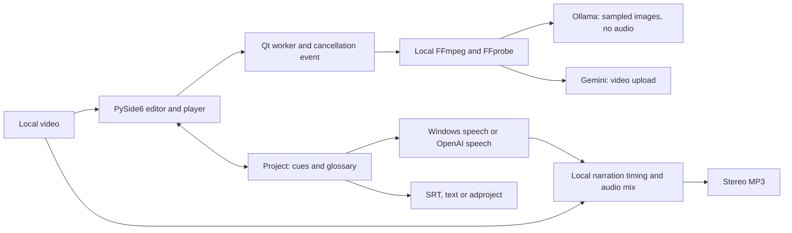
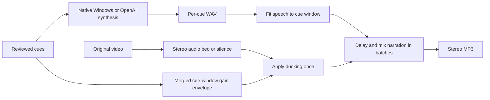

# Architecture and implementation guide

Describer Workbench 0.4.2 · Desktop application and documentation hosting are separate systems.

[User manual](USER-MANUAL.md) · [Repository](https://github.com/scottconverse/Describer-Workbench)

## System overview


The desktop application owns the project and editorial decisions. Qt plays the original video and exposes timed cue editing. Background workers prepare clips and call a selected adapter. Local FFmpeg/FFprobe perform media transformations; native Windows speech can complete the workflow without cloud calls. Ollama receives sampled frames and text. A cloud tag can route those requests beyond the local server. Gemini receives prepared video, with audio unless removed. OpenAI receives narration text only for its optional speech path.



## Source map

| Module / file | Responsibility |
| --- | --- |
| `run.py`, `describer/__init__.py` | Entry point and application version. |
| `describer/app.py` | Main window, editing, media player, snapshots, confirmations, Qt workers, scene dialogs, import/export/update actions. |
| `describer/model_picker.py` | Provider selection, exact IDs, discovery labels, editable tags, range choice and connection-test coordination. |
| `describer/models.py` | Ollama endpoint validation, metadata, capability checks, local/cloud heuristics, streaming chat, profiles, image extraction and errors. |
| `describer/services.py` | DPAPI settings, media tools, segment generation, Gemini adapter, dispatch, generation coordinator, yt-dlp and audio export. |
| `describer/project.py` | Cue/time validation, generated-result normalization, subtitles, project JSON, SRT/text export and scene grid validation. |
| `describer/windows_speech.py` | SAPI 64/32-bit and OneCore hosts through isolated PowerShell processes. |
| `describer/playback_speech.py` | Playback speech interruption/queue policy and optional active screen-reader routing. |
| `describer/compatibility.py` | Explicit read-only original-data import, preference mapping and glossary merge. |
| `describer/catalogue.py`, `describer/i18n.py` | Editorial/voice defaults, translation application and RTL behavior. |
| `describer/diagnostics.py` | Rotating log configuration and configured-key redaction. |
| `describer/updates.py` | Feed parsing, hash-checked staging, safe extraction and portable installation/rollback helper. |
| `DescriberWorkbench.spec`, `build.ps1` | Frozen module/data collection, native-reader DLLs and portable build. |
| `tests/` | Unit/regression tests and opt-in machine/media acceptance scripts. |
| `docs/`, `website/`, `tools/build_site.py` | Documentation source, static presentation and HTML renderer. Not part of inference/runtime. |

## Analysis lifecycle


```mermaid
sequenceDiagram
    actor Editor
    participant UI as Qt window
    participant Worker
    participant Media as FFmpeg
    participant AI as Selected provider
    Editor->>UI: Choose model, range, prompt; Analyze
    UI->>UI: Confirm replacement and applicable transmission
    UI->>Worker: Copied project/settings, cancellation event
    loop Sequential chunks
        Worker->>Media: Prepare bounded clip
        alt Ollama
            Media-->>Worker: Up to eight 640px frames
            Worker->>AI: Exact tag, images, prompt, request profile
        else Gemini
            Worker->>AI: Upload clip and request JSON
        end
        AI-->>Worker: Reply or error
        Worker->>Worker: Parse, normalize, offset times; merge glossary
    end
    Worker-->>UI: Complete cue list and glossary, or failure
    UI->>UI: Replace only after successful completion
    Editor->>UI: Review, edit and save
```

The current range selection is whole video or 20/60 seconds from playhead. `generate()` bounds the stop time to video length. Chunking uses the configured duration; Ollama adds the eight-frame-interval ceiling even when chunking is disabled. At the default two-second interval, the ceiling is 16 seconds. Ask uses a separately prepared scene window and distributes at most eight frames over it; Explore requests a two-second region.

Worker objects move to GUI-owned QThreads and emit completion/failure/log signals. Long operations use copied settings/projects rather than live editor objects. Generation is committed only at completion, so partial or rejected output does not replace current cues. Cancellation is cooperative: subprocess polling and streamed-event checks can stop work, but an idle HTTP read may wait for its timeout. The window waits for workers during close rather than discarding a running QThread.

### Response and timing contracts

Providers are asked for JSON descriptions with numeric clip-relative seconds. Auto glossary adds a structured visual-identity list. Tolerant generated normalization skips malformed rows, removes consecutive duplicates, repairs overlaps and bounds times; strict project/import parsing instead rejects invalid content. Chunk cue times are offset into the absolute video timeline and normalized once more.

This pipeline checks structure, not perception. It cannot establish that a returned action occurred, that an omitted action is unimportant or that a cue fits a dialogue gap. Images lack continuous motion and Ollama receives no audio. A successful request or parse is not editorial acceptance.

## Ollama request profiles

`models.chat()` starts with streaming enabled, an 8,192-token output ceiling and the configured temperature. Exact matches `gemma4:12b`, `gemma4:26b` and `qwen3.8:27b-q6_K-vision` replace options with 32,768 output/65,536 context, omit temperature and set `think:false`. A tag starting with `deepseek-v4.1-flash:1017` requests `think:"low"`. These rules are independent of whether the server can actually load/execute the model. Aliases do not automatically map to the tested profiles.

`model_info()` requires reported vision capability. The picker reads tags/loaded models/capabilities without generating. Connection testing still requires vision, then sends a short text-only chat. It proves a narrower path than frame/JSON analysis. Local JSON calls request `format:json`; cloud calls omit that unsupported structured-output field while retaining JSON instructions/parsing. Response accumulation is capped at 4 MiB, and missing completion, length stop, empty answer, invalid JSON and network errors propagate as failures. No provider/model fallback is performed.

The root URL must have no credentials, query, fragment or API path; remote HTTP is refused and redirects are blocked. Optional bearer keys are separate settings. Local/cloud classification checks location, metadata and suffixes; it cannot attest to everything a user-operated server does.

## Speech and export pipeline




Native export uses SAPI or OneCore through the selected Windows host. OpenAI synthesis sends cue text with the configured model/voice/speed and supported instructions. Per-cue WAV durations are probed, then FFmpeg tempo filters speed overlong narration to the cue length. Shorter speech is not stretched to fill the interval.

The original soundtrack is decoded/downmixed to 44.1 kHz stereo, or silence is created for no-audio media. Merged cue windows create a gain envelope with 50 ms transitions. The bed is ducked once before narration batches are mixed, avoiding repeated attenuation of previously added speech. Final MP3 does not retain surround layout or embed video. Playback speech is separate from export speech; screen-reader speech duration is controlled by the reader and cannot be measured for precise ducking.

## Data and trust boundaries

| Data / action | Location / boundary |
| --- | --- |
| Original media | User's selected path; project operations do not embed it. Downloads are separately saved by yt-dlp. |
| Project | Versioned JSON at user-selected path; includes absolute video path, duration, cues and glossary. No provider keys. |
| Settings | LocalAppData JSON; three key fields use current-user DPAPI, other preferences remain plain data. |
| Diagnostics | Rotated LocalAppData logs; configured key strings redacted, paths/text may remain. |
| Prepared media | Temporary local clips, frames and audio; normal context-manager cleanup. |
| Ollama loopback | Images/prompts to configured local server; server may route cloud tags onward. |
| Remote Ollama | HTTPS plus confirmation; cloud allowance/account behavior belongs to Ollama/server. |
| Gemini | Confirmed video/audio transmission; deletion attempted in `finally`, no guarantee after provider/cleanup failure. |
| OpenAI speech | Confirmed description-text transmission for selected speech engine. |
| Updates | User-trusted HTTPS/local feed, validated hash/paths/package structure; explicit install/restart and retained rollback. |

There is no automatic media upload merely from opening a local file or choosing a model. Analysis/scene actions and selected speech export cause the documented transmissions. Cancellation cannot reverse them. The optional update feed is not the same as the public download page and is not automatically configured by publishing a release.

## Build and deployment identity

PyInstaller produces a folder bundle: `DescriberWorkbench/DescriberWorkbench.exe` plus `_internal`. The release contains the accepted unsigned 0.4.2 executable with SHA256 `f5a7fcd34998b96fa85089c77b07346df20abe1f43cee9c37e4a0f3e11ed2b13`. The release source tag is `v0.4.2` at commit `5bf93b952369c1342e54faa9f2c857a695430075`. Frozen-module comparison excludes filename/line metadata while comparing recursive code structure. Publication documentation can advance on main without changing that binary/tag identity.

The website is a static Sites deployment. `tools/build_site.py` renders Markdown into HTML and copies the landing page/assets. It has no analysis endpoint, file upload, account system or model credentials. Download buttons link to the GitHub release. Static hosting does not run the Windows application; editorial work occurs in the installed desktop app.

## Evidence limits

The 0.4.2 acceptance covers 28 passed automated tests, eight actual GUI model requests on a one-minute Bunny segment, requested profile settings, 64K runtime contexts, no truncation/thinking output, project/response correspondence and installed playback. It does not establish full-film quality, a new accuracy ranking, native-speaker translation quality or installed NVDA/JAWS behavior. Gemini/OpenAI/cloud paths have source/fixture coverage without live keyed acceptance. GitHub CI was not configured for the binary release. Historical audit claims must be read with their version and evidence scope.
