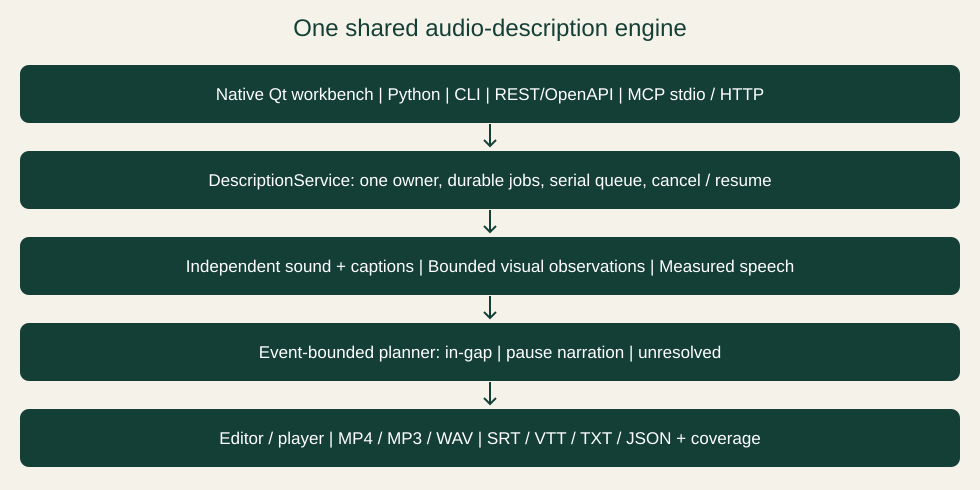

# Technical user and developer guide — 0.7.0

**Editor boundaries:** `editor_history.py` contains existing project
undo/redo commands and keyboard routing; `editor_selection.py` holds cue identity
independently of widgets. Use `Window.choose(index)` and `selected_index()`;
the hidden table is removed. Selection survives sorting and filtering, with a
neighbor selected only after the selected cue is removed. Tests and native
acceptance helpers exercise visible controls rather than obsolete table cells.

Routine tests default to `QT_QPA_PLATFORM=offscreen` before creating QApplication.
This exercises real Qt controls/event delivery without occupying the desktop;
it does not prove native screen-reader output. Source CI runs affected
desktop Ruff F checks and strict mypy on the typed selection model. It does not
claim the older dynamic Window/presentation classes are fully statically typed.

```powershell
$env:QT_QPA_PLATFORM='offscreen'
python -m pytest -q
python -m ruff check --select F describer/app.py describer/desktop.py describer/editor_history.py describer/editor_selection.py
python -m mypy --strict --follow-imports=silent describer/editor_selection.py
```

**Measured export preview:** `export_preview.py` stamps canonical validated cue
data, source/audio file identity, captions and relevant narration settings after
the shared `prepare` pipeline. The preview shares `included_pauses` with the
exporter, never estimates speech from word counts. Missing/stale measurements
are explicit. Measuring uses the existing preflight, consent and job ownership;
the full project transaction applies only if the input fingerprint still matches.
Export remeasures, so the displayed finished duration is approximate. This behavior is included in 0.7.0.

**File compatibility:** Version 0.7.0 reads project formats 1 and 2 and saves format 2. This prevents older 0.6.1 readers from silently dropping cue identity/review metadata on re-save: they reject format 2. Existing version-1 files are not rewritten until explicitly saved; keep an original copy when comparing older and newer applications.

Version 0.7.0 adds a stable `cue_id` separate from `event_id`, plus `origin`, `manually_edited`, `review_status` and `review_history`. Saved project version 1 remains readable; missing legacy fields receive defaults and persist on save. `DraftProposal` uses a complete-project fingerprint, half-open ranges, explicit accepted/replaced cue ID sets and a glossary choice. Conflicting replacements and stale proposals are rejected; boundary-crossing cues remain whole. Desktop application/undo includes coverage and analysis as well as cues/glossary. Edited reviewed/approved facts require review again; provider output cannot assign human approval. See [preservation rules and acceptance status](STABILIZATION.md). These fields persist in 0.7.0 projects.

Windows, macOS and Linux · documentation updated November 5, 2026. [Nontechnical quick start](QUICK-START.md) · [Complete user manual](USER-MANUAL.md).

For the separate macOS/Linux packages, native dependencies, repository installer and build commands, see [the platform installation guide](UNIX-INSTALL.md). Windows packages use Azure Trusted Signing; Unix packages retain their separate integrity policy. Unix builds have separate source/package/acceptance identities and no publisher certificate. The `macOS and Linux add-ons` workflow performs native tests and package installation on Ubuntu 24.04 x64 and macOS 15 arm64/Intel (the 0.7.0 Intel job failed, so 0.7.0 has no Intel DMG); its receipts state which behaviors were actually exercised.

Version 0.7.0: [AI connections](AI-CONNECTIONS.md) documents the new routes and evidence limits. Timed narration is synthesized and measured independently of the live-text screen-reader route. New/repair cues record `audio_volume:100`; target gain is `speech_volume / audio_volume`. The desktop prompts repair for older cues with unknown synthesis level. The shared service prepares narration before media export; the raw exporter rejects unknown recorded levels. User and model text remain unchanged when repairing audio.

Reported usage persists with operation and requested/reported model identity. Automatic glossary generation shares the description request; such records have `components:["description","glossary"]` and explicitly unavailable separate glossary counts. The desktop labels that combined category and never fabricates a split or a subscription dollar cost. Scene requests remain separately attributed; unavailable provider token fields remain unknown.

Job status includes `pipeline` stage completion/percentage and available `usage`. Gemini `MAX_TOKENS` produces an error job plus `partial_response` metadata pointing to a separate `partial-response.json` with `complete:false`. Python can inspect it with `service.partial_response(job_id)`; the desktop's recovery dialog provides a read-only view. Configured keys are redacted. Safety-blocked responses are not recovered. Failed jobs have no completed result or export; use a shorter chunk in a new request. Existing upload cleanup and bounded retry behavior remain in force.

New image adapters share a source-time FFmpeg sampler with at most eight640px images. Actual decoded timestamps accompany the images; interval-centred frames are not labeled as interval starts. Native CLI child environments use a process/home/locale/proxy/TLS allowlist and exclude API-credit overrides, ADC authentication overrides and unrelated secrets. Provider-global settings and default model selection are not changed.

`timing_start` / `timing_end` retain authored narration windows separately from `event_start` / `event_end` visual provenance. Conservative shortening is attempted only when measured original speech cannot fit; recognized redundant lead-ins may be removed, the new WAV is measured, and `narration_text` records accepted spoken wording while `text` and evidence retain the original. Other no-fit cues retain pause fallback. The accepted quality disposition requires human review and correction; coverage is a placement account, not a factual-recall metric.

The Windows updater uses the official latest stable GitHub release when the configured feed is blank. It checks the archive digest, requires timestamped Valid Scott Converse signatures on both Windows executables, and rechecks all staged payload hashes before applying. Manual signed-package acceptance: `python -m tests.update_acceptance SIGNED_ARCHIVE NEW_OUTPUT_DIRECTORY`. Real portable relaunch acceptance: `python -m tests.portable_update_acceptance prepare NEW_OUTPUT_DIRECTORY OLD_INSTALL VERIFIED_STAGED_DIRECTORY`, then close only its disposable window and run the same module with `verify NEW_OUTPUT_DIRECTORY`. These scripts write new receipts beside their disposable installation and preserve historical evidence. A requested launch alone does not verify the running application.

See [0.7.0 release acceptance](V070-ACCEPTANCE.md) for verification scope and limits. The distributed Windows GUI and CLI are signed as Scott Converse using Azure Trusted Signing with Microsoft timestamps. Windows source builds require the [release signing procedure](CODE-SIGNING.md) before publication; the explicitly authorized Mac/Linux distributions use the separate integrity policy below.

Describer Workbench has one headless engine. The Qt desktop, Python API, CLI,
REST API and MCP tools call the same `DescriptionService`. No WSL, Docker,
desktop window or paid service is required for local processing.

Editor text changes use `TextEdit`, which retains one cue and its
coverage row per undo group. It updates existing list items and timeline buttons; it does not refresh the whole workspace. A 1.2-second
pause, cursor navigation, focus/cue change or other operation separates groups.
Keyboard and context-menu undo share the project stack. Timing/structural edits
continue through full `CueEdit` transactions. `cue_accessible` supplies the same
semantic name for native list accessibility and timeline controls. Actual Windows
NVDA evidence and cross-platform source-check limits are in the stabilization
record; accessible Qt metadata alone is not proof of a reader workflow.

`project_recovery.DraftStore` atomically writes format-2 project
snapshots plus original path, source size/mtime and pending editor fields beneath
`unsaved-drafts` beside the settings file. It copies project data, not settings or
credentials. The desktop's 30-second timer runs only while dirty and idle;
unchanged content is deduplicated. Retention is 3 per project, 20 total, 50 MiB,
10 MiB per snapshot. Pruning is limited to validated owned files in that resolved
directory and excludes symlinks. A recovered project has no active save path.
Save As changes the active path only after atomic project persistence succeeds.
Engine jobs/checkpoints remain separate. The native crash acceptance helper uses
a disposable profile/video and intentionally exits its child with code 23 after
the actual timer fires; it verifies full-state recovery and unchanged originals.

`engine.speech_cache` stores disposable validated classification JSON
under the host data folder's `speech-cache`, shared across engine jobs. The cache
key includes actual media/detector/decoder/implementation hashes and inference
runtime versions; it excludes the vision provider/model and requested range,
which cannot change independently measured source audio. A changed detector,
decoder or implementation invalidates reuse. Captions are always imported and
applied afresh. Existing per-job checkpoints remain separate. Corrupt cache data
is recomputed; cancellation never publishes partial data. Per-key advisory locks
avoid duplicate measurement and remain responsive to cancellation. Cache I/O
failure preserves fresh analysis. Source builds hash `sound.py`; frozen builds
hash the executable, since bundled Python sources may not exist as files. Cache
entries can be removed while the app/engine is stopped; they are regenerated.

Drafting retains `ModelPicker`'s transactional settings. The simple
connection selector and Advanced provider cards synchronize through its existing
provider control; exact-model selection and all discovery/testing paths remain.
Range and transmission/preservation disclosure remain outside the Advanced
scroll area. Accept validates/stores the exact visible model before invoking the
existing analysis/consent path. Cancel restores settings/prompt/preset. Advanced
expansion is bounded by available screen height; dialog teardown reparents the
shared editorial widgets and stops its status timer before deferred deletion.

## Install

Install the source checkout with the interfaces you need:

```powershell
python -m pip install ".[local,http,mcp]"
# Desktop additionally needs:
python -m pip install ".[desktop,http,mcp]"
```

Core installs do not depend on Qt. Local speech detection needs the `local`
extra, FFmpeg/FFprobe and a pinned YAMNet asset. Install an Ollama vision model
separately. Windows voices provide offline narration on Windows. The add-ons
provide measured macOS voices and Linux eSpeak NG; install their native dependencies
as described in the platform guide. Optional OpenAI speech remains a
remote, explicitly authorized alternative.

Provision the classifier explicitly; opening a file never downloads models:

```powershell
describer assets provision
```

New code is Apache-2.0. See LICENSE, NOTICE and third-party notices. Attributed
original translations and dependencies retain their own licenses.

## Host configuration and installed commands

| Host | Desktop / CLI | Native narration | Credential backend |
| --- | --- | --- | --- |
| Windows ZIP | `DescriberWorkbench.exe` / `DescriberCLI.exe` | `Windows`, `Windows 32-bit`, `Windows OneCore` | Current-user DPAPI |
| macOS DMG | `/Applications/Describer Workbench.app` / `Contents/MacOS/DescriberCLI` inside it | `macOS` | macOS Keychain |
| Linux DEB | `describer-workbench` / `describer` | `eSpeak NG` | Desktop Secret Service |
| Linux tar | `DescriberWorkbench` / `DescriberCLI` in the extracted directory | `eSpeak NG` | Desktop Secret Service |
| Source environment | `describer-workbench` / `describer` in that environment | Host native engine | Host backend |

Default data folders are Windows `%LOCALAPPDATA%/DescriberWorkbench`, Mac `~/Library/Application Support/DescriberWorkbench`, and Linux `${XDG_DATA_HOME:-~/.local/share}/DescriberWorkbench`. Desktop settings/logs are there; durable jobs default to `engine` below it, overridden by `DESCRIBER_HOME/engine`. An explicit service/CLI workspace is independent. Unix keyrings must be available/unlocked; settings retain opaque references and have no plaintext fallback. Request JSON can contain raw credentials: protect it separately and do not confuse it with the desktop's protected settings file.

On Mac/Linux, install native dependencies then run `python3 tools/install_unix.py` from the repository for a per-user environment and launcher. The installer prints its paths; use that environment's CLI, not an unrelated Python. For a custom environment, use `python3 -m venv .venv`, activate it and install the extras above. Intel Mac source installation may require Rust, OpenSSL/pkg-config and Xcode tools; DMGs require none of that build toolchain. The [platform guide](UNIX-INSTALL.md) has complete prerequisites and removal instructions.

## Python API

```python
from describer.engine import DescriptionService

with_settings = {
    "analysis_provider": "Ollama",
    "ollama_model": "gemma4:12b",  # exact installed vision tag
    "voice_engine": "Windows",  # use "macOS" or "eSpeak NG" on those hosts
}
service = DescriptionService(r"C:\work\describer-jobs", with_settings)
try:
    job = service.submit(source=r"C:\media\meeting.mp4")
    print(job["id"])
    project = service.wait(job["id"])
    print(service.read(job["id"], offset=0, limit=50))
    print(service.coverage(job["id"]))
    export = service.export_job(job["id"], export_format="mp4")
    service.wait(export["id"])
    print(service.get_job(export["id"])["artifact"])
finally:
    service.close()
```

The example uses Windows paths. On Mac/Linux use absolute POSIX paths such as `~/Movies/meeting.mp4` expanded with `Path(...).expanduser()` and a writable workspace; select that host’s engine string from the table. Do not reuse Windows voice IDs or copied encrypted credentials.

`submit(project=...)` accepts an existing `Project`, an `.adproject` path or
project JSON. Original media is read-only. Result edits use `edit(job_id,
revision, cues=..., glossary=...)`; stale revisions are refused. Editing text or
timings invalidates its narration placement and requires export re-planning.

Jobs are durable JSON records with hashed stage checkpoints, a serial worker,
cooperative cancellation and explicit resume. After an owner exits, running or
queued jobs become `interrupted`, not successful. `resume(job_id, settings=...)`
retains completed stages only if source, local model digest, parameters and engine identity
match. Provider keys are never written to jobs/checkpoints; supply keys again
after restarting a cloud-backed engine. Cancellation cannot undo a sent cloud
request. A waiting read can take up to its configured timeout.

Observation checkpoints are reusable only after whole-chunk timestamp, text, metadata and glossary validation. Rejected provider data is retained under `stages/rejected-*.json` with `complete:false` and its stage name; it is diagnostic data, not a project result. A rejected chunk is retried in the job (`chunk_retries`, default 2). If every try fails, the job finishes as `done_with_gaps`: results are readable, the job's `failed_chunks` lists each hole (`start`, `end`, `error`), coverage has a `failed_chunk` row for it, and the CLI exits with code 2. Resume requests a corrected response for each failed chunk while retaining validated earlier chunks. A legacy invalid cached stage is preserved under `invalid-*.json` instead of being reused. These files can include provider text and should be inspected before sharing. Changed implementation identity still requires a new job rather than resuming an older executable's work.

One process owns a workspace. Do not start multiple owners against the same
directory. Clients sharing desktop jobs attach to its HTTP service. Separate
workspaces are independent installations, not a cluster.

## CLI

The Python console entry point is `describer`; `describer-workbench` opens the desktop. The Windows portable folder also contains `DescriberCLI.exe` with the same arguments, including `mcp` and `serve`; no Python installation is needed for that build.
Use `describer --help` and subcommand help for actual argument names. Settings
files are ordinary request JSON, not the host-protected desktop settings file. Avoid persisting raw keys; supply only credentials needed for the request through the supported service/environment route.

```powershell
describer --workspace C:\work\jobs --settings local.json describe C:\media\meeting.mp4
describer --workspace C:\work\jobs jobs
describer --workspace C:\work\jobs read JOB_ID --limit 50
describer --workspace C:\work\jobs coverage JOB_ID
describer --workspace C:\work\jobs export JOB_ID --format mp4
describer --workspace C:\work\jobs resume JOB_ID
```

Other commands: `capabilities`, `models`, `batch`, `status`, `cancel`, `edit`,
`ask`, `explore`, `scene`, `voice`, `serve` and `mcp`. Batch JSON is a list of
submission objects; up to20 items are admitted, with per-item results/errors.
Local describe/ask/explore/voice, batch, resume and export commands wait for their jobs before exiting. Remote describe/ask/explore/voice also wait by default; remote batch, resume and export return job handles, so poll status before reading results. `--no-wait` submission requires
`--server-url`, so exiting a short-lived CLI cannot abandon its owning worker.

## HTTP API

Set `DESCRIBER_API_TOKEN` to a private random secret of at least16 characters.
Then run `describer --workspace C:\work\jobs --settings local.json serve`.
The default bind is loopback port8796. Every HTTP request, including documentation
and MCP, requires `Authorization: Bearer TOKEN`. Do not put the token in a URL.
Use a TLS/auth gateway for a deployment outside the machine; that deployment is
separate from the local server. Cross-origin requests and non-loopback Host
headers are refused. The API can read files available to its operating-system account;
granting its token grants that capability. Do not give it to untrusted websites.

OpenAPI schema: authenticated `GET /openapi.json`. The API defines:

| Method | Path | Operation |
| --- | --- | --- |
| GET | `/capabilities` | Version, operations, resource limits |
| POST | `/models` | Selected-provider discovery where supported; settings JSON body. Catalog listing is not entitlement or vision proof. |
| POST | `/jobs` | Submit describe/export/ask/explore/voice-preview/prepare; returns202 |
| POST | `/jobs/batch` | Batch submission |
| GET | `/jobs` | List/filter jobs |
| GET | `/jobs/{id}` | Progress and terminal state |
| POST | `/jobs/{id}/cancel` | Request cancellation |
| POST | `/jobs/{id}/resume` | Resume with optional settings JSON |
| GET | `/jobs/{id}/descriptions` | Page/time-filtered cues |
| GET | `/jobs/{id}/coverage` | Event dispositions and unresolved information |
| PATCH | `/jobs/{id}/project` | Revision-checked cue/glossary edits |
| POST | `/jobs/{id}/export` | Start export; format/settings/mode JSON |
| GET | `/jobs/{id}/scene` | Completed question/spatial result |
| GET | `/jobs/{id}/artifact` | Download completed export/voice artifact |

Submission fields are `source` or `project`, `settings`, `prompt`, `start`,
`duration`, `operation`, `export_format`, `mode`. Read pagination filters by the original event interval, not a shifted narration slot. `total` is the filtered count. Pagination uses `offset`,
`limit` (1..500), optional `start`/`end`. Poll terminal states `done`, `done_with_gaps`, `error`,
`cancelled`, `interrupted`; do not keep polling an error. Media is not embedded
in job status or MCP tool responses.

Cloud inference/speech requires `settings.allow_cloud=true`. Keys can be supplied
in settings or service configuration. CLI can read `DESCRIBER_GEMINI_API_KEY`,
`DESCRIBER_OPENAI_API_KEY` and `DESCRIBER_OLLAMA_API_KEY`. These are explicit
processing requests, not telemetry. Telemetry/exporter auto-configuration is
disabled; ONNX Runtime telemetry is disabled before inference.

The desktop's **File → Start developer API / MCP** uses the same in-process
engine and writes its bearer token to the private workspace's `api-token.txt`.
Stop it using **File → Stop developer API / MCP**; the same controls are in Settings → Developer API. Closing the desktop stops that server.

## MCP

Standalone stdio configuration for a harness (Windows example; replace absolute paths):

```json
{
  "mcpServers": {
    "describer": {
      "command": "C:\\path\\to\\python.exe",
      "args": ["-m", "describer.adapters.mcp", "--workspace", "C:\\work\\jobs"]
    }
  }
}
```

On Mac/Linux, a source install can use its absolute environment Python path and POSIX workspace. A native package can use its absolute CLI executable; the shared global form is `DescriberCLI --workspace /absolute/jobs mcp`. In JSON use `"args": ["--workspace", "/absolute/jobs", "mcp"]`. No Windows Python path is portable.

To share an already running desktop/server engine, replace `--workspace ...`
with `--server-url http://127.0.0.1:8796` and provide `DESCRIBER_API_TOKEN` in
the subprocess environment. This is a stdio-to-service adapter, not another
inference owner. Developer Python/CLI clients can attach in the same way using
`RemoteService` or `--server-url`.

Streamable HTTP endpoint: `http://127.0.0.1:8796/mcp/`, using the same bearer
header. It is mounted in the HTTP server and shares job IDs and queue ownership.
No obsolete separate HTTP+SSE transport is implemented. MCP negotiation belongs
to the SDK; support in a particular harness must be verified rather than
inferred from the words "supports MCP".

Tools: `capabilities`, `list_models`, `submit_description`, `submit_batch`,
`get_job`, `list_jobs`, `cancel_job`, `resume_job`, `read_descriptions`,
`get_coverage`, `edit_descriptions`, `export_descriptions`, `ask_scene`,
`explore_scene`, `read_scene`, `preview_voice`, `get_artifact`.

## Results and complete exports

Each cue retains its observed `event_start`/`event_end`, event ID, kind, evidence,
uncertainty, narration duration and placement. A cue's output `start`/`end` may
differ after safe placement, but the engine does not move the source event.
Only exact duplicate observations of the same interval/event are removed;
identical words at different times survive.

Independent speech/vocal detection plus supplied captions protect the original
audio. Measured narration can accelerate at most1.15x. A cue that cannot fit
within a safe part of its event becomes `pause`; uncertain observations become
`unresolved`. The engine does not erase either category to obtain a green count.

Complete MP4/MP3/WAV exports insert pause narration into an extended timeline
(MP4 freezes the current image). Unresolved observations refuse a complete media
export. Explicit `mode=in-gap-only` produces an incomplete track and records that
fact. SRT/VTT/text/project exports are scripts, not proof of a complete narrated
track; their sidecar retains pause/coverage information and original event times.

Coverage accounts for observed events. It does not establish that the model
found every essential visual fact or that its statements are true. This version
does not certify legal accessibility compliance or claim99% visual accuracy.

## Packaging, updates and documentation identity

Windows retains its published Azure Trusted Signed GUI/CLI and portable layout. macOS 15+ DMGs are separate arm64/x64 bundles (0.7.0 ships arm64 only) with ad-hoc integrity signatures only, without Apple publisher signing/notarization. Linux x64 DEB/tar use package-managed media and speech. `DescriberUnix.spec`, `tools/build_unix_media.py` and `tools/package_unix.py` own native add-on packaging; they do not replace `DescriberWorkbench.spec` or `build.ps1`. See [build commands](UNIX-INSTALL.md#install-from-the-repository) and [signing policy](CODE-SIGNING.md).

Unix updates open the add-on release page and are installed manually. Windows alone uses signature-gated ZIP staging/rollback. Never send a DMG/DEB through that Windows updater. Current guides may be refreshed separately from application code. A documentation manifest records source and guide hashes; historical application receipts retain their original source/test/artifact identities. A Mac documentation refresh must reseal the resource envelope and verify ad-hoc integrity; it does not establish Apple publisher identity. No application acceptance is invented by regenerating docs.

## Shared architecture



See the [architecture guide](ARCHITECTURE.md) for ownership, timing and data boundaries.

Remote hosted model aliases can change upstream without a locally verifiable weight digest. Local Ollama model identity uses the digest reported by `/api/tags`.


## Recovery and export semantics (0.5.2)

The common service now accepts `operation="prepare"` to repair narration/placement without vision, using the same durable queue and `core.plan_export` path. It requires speech consent for OpenAI. Both submit and resume check actual-operation cloud permissions; text-only export does not require unrelated speech consent. No GUI dialogs are introduced into developer operations.

`edit` retains existing observation metadata when identity is unambiguous. Preserve `event_id` when changing text and timing together; ambiguous edits involving unresolved observations are rejected instead of silently dropping review safeguards. Stale narration is invalidated.

`damaged_jobs` exposes paths of unreadable/invalid records; these records are excluded from usable job lists and retained unchanged. Valid jobs and owner locking remain available. Desktop recovery uses original job settings, current credentials, and normal checkpoint identity checks.

Developer exports intentionally replace an existing final target and coverage sidecar without interactive confirmation. Callers must choose/approve those destinations. Temporary staging files are uniquely created and owned, so an existing predictable `.partial` file is not used as scratch. Desktop exports add interactive overwrite confirmation and early destination checks.
