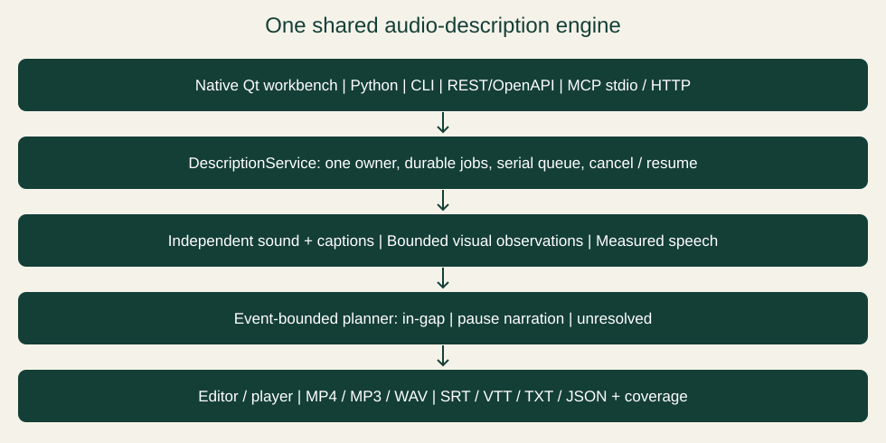
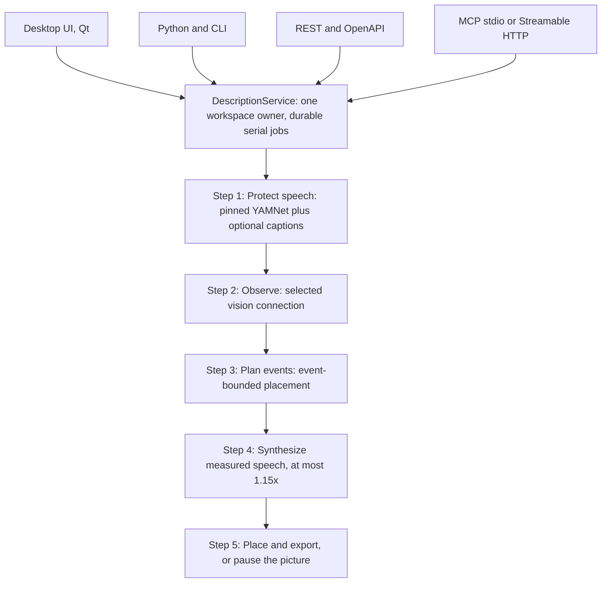
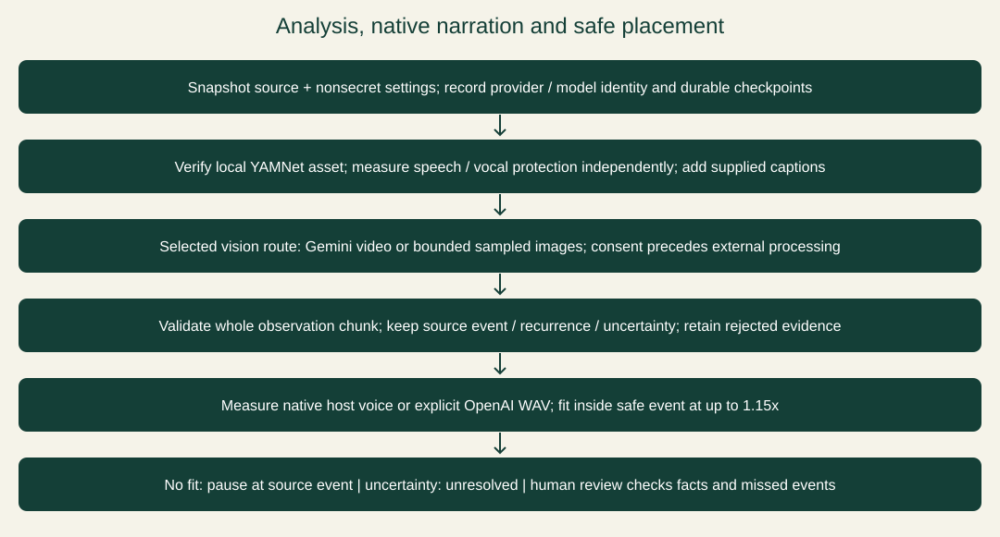
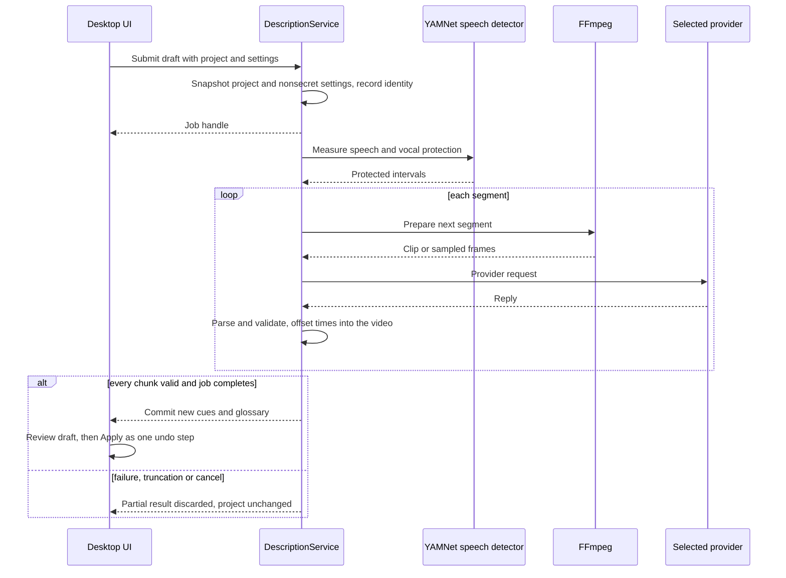
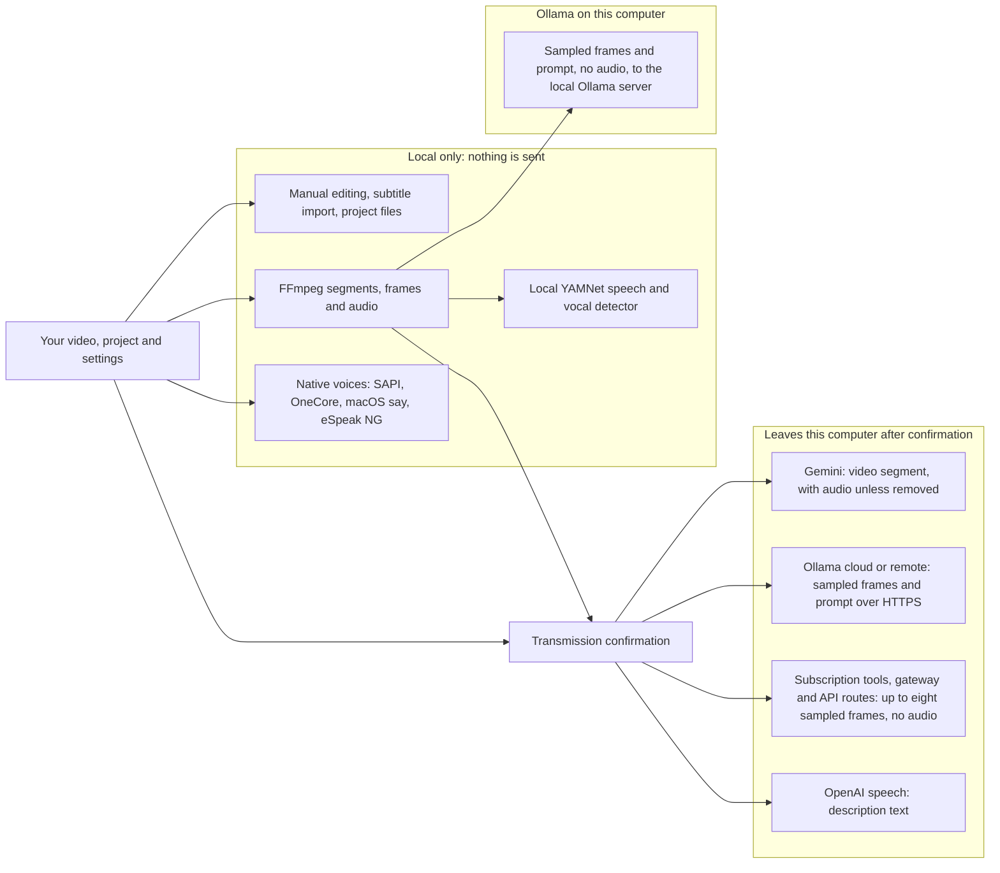
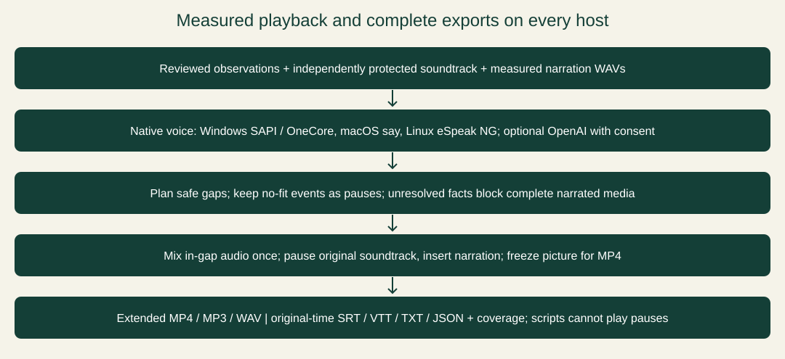
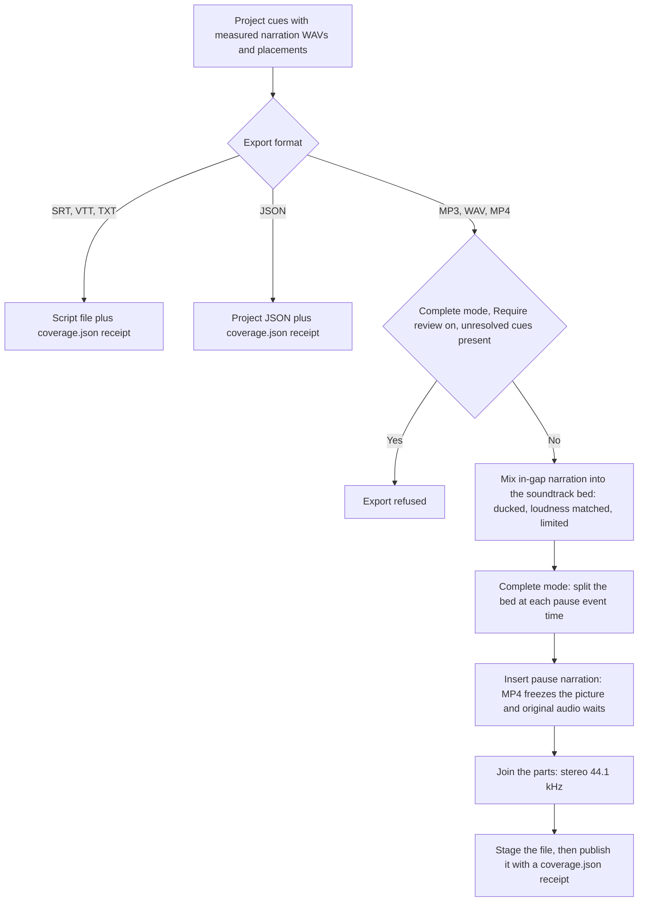

# Describer Workbench user manual

## About this manual

This manual covers Describer Workbench **0.8.4**, updated November 13, 2026 (America/Denver). Describer Workbench is a desktop app for Windows, macOS and Linux. It drafts audio description for video with AI, lets you edit and time each description, and exports described video, narrated audio and subtitles. The same engine is also available from Python, a command line, a REST service and MCP.

| Part | Who it is for |
| --- | --- |
| [Part I: Everyday use](#part-i-everyday-use-no-programming-required) | Editors and describers. No programming needed. |
| [Part II: Technical reference](#part-ii-technical-reference) | People who build from source, connect other software, or extend providers. |
| [Part III: Architecture](#part-iii-architecture) | Developers and reviewers who want to know how the pieces fit and what leaves the computer. |
| [Appendix: Version history](#appendix-version-history) | Anyone who wants to know what changed in each version. |

Links: [Quick start](QUICK-START.md) · [0.8.4 release page](https://github.com/scottconverse/Describer-Workbench/releases/tag/v0.8.4) (notes, verification receipt and checksums) · [Architecture guide](ARCHITECTURE.md) · [Developer guide](DEVELOPER-GUIDE.md) · [Platform installation guide](UNIX-INSTALL.md) · [AI connections](AI-CONNECTIONS.md) · [Project page](https://github.com/scottconverse/Describer-Workbench). The [0.7.0 acceptance record](V070-ACCEPTANCE.md) keeps the earlier stabilization checks and limits.

**Windows, macOS and Linux share the 0.8.4 release.** The workflows in this manual are the same on all three. Some details differ by computer:

- Windows uses `DescriberWorkbench.exe`, DPAPI key storage, SAPI or OneCore voices and a signed updater.
- macOS uses Keychain and measured macOS voices.
- Linux uses Secret Service and measured eSpeak NG voices.
- On Mac and Linux, the update command opens the manual download page.
- Only Windows carries publisher signing. Mac and Linux acceptance has its own release receipts. It does not inherit Windows acceptance or signing.

The [platform installation guide](UNIX-INSTALL.md) covers the Apple Silicon DMG, the Linux x64 DEB and portable archives, and repository installation.

---

## Part I: Everyday use, no programming required

> **Read this first: AI drafts can be wrong.**
>
> - An AI draft is a starting point. Source comparison of three 120-second clips found improvements and also remaining errors. These included a wrong person in low light, an omitted short object sequence and uncertain printed text.
> - **Review is optional since 0.8.4.** Export works without a person checking the cues. Before 0.8.4, the quality workflow required reviewed drafts.
> - Cues the AI marked as unsure keep the **Needs review** tag. They are spoken too.
> - To make review required, turn on **Require review before media export** in Settings → Export voice. Then any Needs review cue blocks MP4, MP3 and WAV export.
> - A Needs review marker catches uncertainty the AI stated. A cue without the marker is not proven correct.
> - If you review, check missed speech and visual facts first (see [section 6](#6-edit-and-review-descriptions)).

### 1. What you can make

Describer Workbench helps you write short spoken descriptions of what a video shows. Each description is a **cue**: a start time, an end time and text. You can write cues yourself, import subtitles as a starting point, or ask an AI model to draft them. Then you correct and listen to the result.

The outputs are:

- an editable project;
- SRT, VTT, plain text or project JSON;
- narrated MP3 or WAV;
- a described MP4.

Complete media exports include descriptions that do not fit a quiet gap by pausing the source. In an MP4, the picture freezes at the original event while narration plays, then the video resumes. This makes the finished video longer. It does not create an alternate audio track you can switch on and off.

Every native package contains the desktop app and a command-line tool (CLI). The CLI also provides REST and MCP access. The CLI is named `DescriberCLI.exe` on Windows, `Describer Workbench.app/Contents/MacOS/DescriberCLI` on Mac, and `describer` (DEB) or `DescriberCLI` (tar) on Linux. Older 0.4.2 downloads do not contain the shared engine or these transports.

Two limits matter for reviewers. First, the Ollama route sees still images sampled from the video and gets no audio. It cannot know when someone is speaking and cannot confirm a spoken name. Second, the engine measures speech and vocal sounds separately with a local detector (YAMNet). It never asks the vision model to guess safe gaps in dialogue.

### 2. Install and choose a working mode

Pick your computer in the table. [The quick start](QUICK-START.md) gives a short first-project walkthrough.

| Computer | Download | Install and start | Publisher signing |
| --- | --- | --- | --- |
| Windows x64 (Windows 11 tested) | [Portable ZIP](https://github.com/scottconverse/Describer-Workbench/releases/download/v0.8.4/DescriberWorkbench-0.8.4-windows-x64.zip) | Extract everything. Open `DescriberWorkbench/DescriberWorkbench.exe`. Keep `_internal` beside it. | Scott Converse, Azure Trusted Signing with Microsoft timestamps |
| Mac, Apple Silicon, macOS 15+ | [arm64 DMG](https://github.com/scottconverse/Describer-Workbench/releases/download/v0.8.4/DescriberWorkbench-0.8.4-macos-arm64.dmg) | Open the DMG. Drag the app to Applications. | No Apple publisher certificate or notarization. Ad-hoc integrity only. |
| Mac, Intel, macOS 15+ | No Intel DMG (dropped in 0.7.0) | Install from the repository. See the [platform guide](UNIX-INSTALL.md). Not tested on Intel. | None (source install) |
| Ubuntu 24.04 or compatible Debian desktop, x86-64 | [DEB installer](https://github.com/scottconverse/Describer-Workbench/releases/download/v0.8.4/DescriberWorkbench-0.8.4-linux-x64.deb) | `sudo apt install ./DescriberWorkbench-0.8.4-linux-x64.deb`. Open Describer Workbench from the applications menu. | Unsigned |
| Other Linux x86-64 desktops | [Portable tar](https://github.com/scottconverse/Describer-Workbench/releases/download/v0.8.4/DescriberWorkbench-0.8.4-linux-x64.tar.gz) | Extract. Run `DescriberWorkbench/DescriberWorkbench` after installing the native dependencies. | Unsigned. Other distributions are not acceptance-tested. |

Compare each download with the checksums on the release page. Prerequisites, approval prompts, updates and removal for Mac and Linux are in [the platform guide](UNIX-INSTALL.md).

**Windows details.** Download the portable ZIP, extract everything and open `DescriberWorkbench/DescriberWorkbench.exe`. Keep the `_internal` folder with the executable. The GUI and CLI executables are signed as Scott Converse using Azure Trusted Signing with Microsoft timestamps. The package includes the application runtime and media tools. It does not include Ollama, AI model weights or videos.

Choose one of these ways to work:

| Mode | Setup | Best first task |
| --- | --- | --- |
| Manual or offline | No AI key. Use your platform's installed native voices. | Open a video, add one cue, listen and export. |
| Local AI | Install and start Ollama. Install a vision model separately. | Choose Ollama, refresh models, test a short range. |
| Gemini | Enter your Google Gemini API key and model in Settings. | Confirm the upload and analyze a short clip. |
| Ollama cloud or remote | Set up sign-in or access in Ollama or on the remote server. | Pick a vision-capable tag and confirm the transmission. |
| Subscription tools, gateway or compatible API | Follow [AI connections](AI-CONNECTIONS.md). | Draft a short range. |

AI connections include gateway subscriptions, native Codex, Claude and Antigravity tools, named OpenAI-compatible profiles and a separate Anthropic API route. Catalog entries do not prove image support or account entitlement. No route falls back to another model by itself. API credits and subscription access are separate. OpenAI speech is an optional text-to-speech service.

No key is needed for manual editing, subtitle import, local playback or native speech. A local AI model needs enough RAM and VRAM for that model. The app does not estimate hardware requirements.

### 3. Your first project

1. Choose **Open video** (Ctrl+O). Select a local video such as an MP4 of Big Buck Bunny. Use the video file itself, not an SRT subtitle, a soundtrack or a folder. The default selector lists MP4, MKV, MOV, AVI and WebM. **All files** shows other files, but the file must still decode.
2. Use the **Play/Pause icon** to check playback and sound. Click the timeline to jump. **−10 s** and **+10 s** move in ten-second steps. Ctrl+wheel zooms the timeline around the pointer. The wheel or the bottom scrollbar pans the visible range.
3. Choose **Add at playhead** in Descriptions. This creates a three-second cue, clipped to the end of the video. Edit Start, End and the description text in place. Changes apply as you type. **Ctrl+Z** undoes them.
4. Save with Ctrl+S and choose a name ending in `.adproject`. The project points to your video. It does not copy it. Keep the video available.
5. Select the cue in Descriptions. The player jumps to the cue's start. Turn on **Speak descriptions**, then play. Adjust the **Video** and **Speech** sliders beside the playback controls. Speech volume is also in Settings.
6. Fix the words or timings. Save again. Use **Export → Subtitles · .srt** for a simple first output, or choose MP3 for spoken narration mixed with the soundtrack.

For an AI first draft, save your project, move to the intended start and follow [section 5](#5-draft-with-ai). Start with **Next 20 seconds** or **Next 60 seconds** before you ask for a whole film.

### 4. Find your way around

**Start screen.** It opens videos, URLs and saved projects. It has three action cards: Open video, From URL and Open project. Saved projects appear under Recent projects. You can also drag a local video or an `.adproject` file into the window. The app asks about unsaved changes first.

**Editor.** Video and transport controls sit above a timeline you can seek. Descriptions, Scene and Glossary tabs sit beside them. The model chip shows the exact model ID you selected. The status line counts ordinary in-gap, sped-up, pause and review cues separately. The toolbar Open action returns to Start. The Theme button switches between light and dark.

**Timeline.**
- Ctrl+wheel zooms around the pointer. The wheel or bottom scrollbar pans.
- The visible range follows the playhead. Selecting a description brings it into view.
- The picture lane shows eight frames from the visible range and refreshes after you zoom or pan. A still scene can show repeated frames.
- Sped-up description blocks have diagonal stripes.
- Description buttons on the timeline can be reached with the keyboard. Activating one selects the cue and jumps to it.

**Menus and jobs.** The **File** menu holds projects, subtitle import, glossary, prompt presets, connection and sign-in tools, voice tools, original-data import, recovery and update checks. **Help** (F1) opens brief built-in help and shows the app version. **Draft with AI** opens connection, range and instruction controls. The job card cancels active work. **View → Log** opens diagnostics. Some actions are unavailable while a background job runs. Wait for it to finish or cancel it.

| Shortcut | Action |
| --- | --- |
| Ctrl+O | Open video |
| Ctrl+U | Download and open from a URL |
| Ctrl+Y | Open YouTube through the same download workflow |
| Ctrl+Shift+O | Open project |
| Ctrl+S | Save project (inline edits already apply) |
| Ctrl+Shift+S | Save project as |
| Ctrl+I | Import SRT or VTT after opening a video |
| Ctrl+, | Settings |
| Ctrl+E | Export |
| Ctrl+Z, Ctrl+Shift+Z | Undo, redo cue edits |
| F1 | Built-in help |

Space toggles playback when the keyboard focus is outside text editors. Text editors keep Space for typing. Focused buttons and lists may handle Space themselves. The Play/Pause icon always works. The shortcuts use Qt `Ctrl` sequences. On macOS Qt shows the native command-key equivalent, so use the shortcut shown in your menu. The timeline's Ctrl+wheel modifier is a separate control. Tab follows the normal Qt focus order.

For assistive technology: custom lists paint a visible focus border. Description and timeline accessibility names include the cue number, start and end, placement, review state, text and any stated uncertainty. Primary buttons use white text on darker blue, above 4.5:1 calculated text contrast. See [section 11](#11-accessibility-and-keyboard-use) for what was and was not tested.

### 5. Draft with AI

#### Choose a connection

In **Draft with AI**, choose the connection and section, check the selected model and the transmission notice, then choose **Start draft**. The notice and the Start and Cancel buttons stay visible. **Advanced** opens a scrolling panel with the exact-model and catalog controls, Test connection, provider, preset and prompt, verbosity and glossary controls. If a connection has no model yet, open Advanced to choose one. Switching connections keeps each provider's configured model. Nothing picks a substitute model. Cancel restores your settings and editorial text. External operations still ask for their usual confirmation.

Before you start, the dialog commits your provider and model edits only when you choose Start draft. Cancel keeps the saved settings. Setup shows missing, configured, verified or error. A configured Gemini key is not proof that your account can use the model. Voice readiness refers to the export engine you chose, not your playback voice.

The **Test connection** button checks different things on different routes. Supported subscription and API routes send a synthetic image. Ollama sends a labeled text prompt. Gemini is checked when an operation starts. A passing text test does not prove the model understands video.

#### Local Ollama

Start your separately installed Ollama server. Open **Draft with AI**, choose **Ollama**, then **Refresh models**. Each entry shows the exact ID and any available details: family, quantization, size, context, vision support, location and loaded status. Missing fields stay unknown. One unhealthy entry does not hide the others. You can still type an exact ID. A text-only model cannot analyze video, even if it answers chat prompts. The app does not download model weights or pick a model for you.

Draft first checks the selected speech detector. If it is missing or damaged, the app offers a download or repair and continues only after the SHA256 and ONNX checks pass. Cancel sends no provider request. **File → Install speech detector** repairs a custom detector path as well as the default one. Network reads time out after ten seconds. Cancel waits for a pending read and keeps any earlier valid file. If cancel arrives after the install finishes, the finished install is kept. If the detector is unavailable or changed, analysis and narrated export stop before inference. A file that is already verified can be used offline.

Choose an installed vision entry. To change a tag, select a discovered row, or type the exact ID (without display notes) in the separate **Exact analysis model ID** field. Test connection and Start draft use that exact ID. Test connection checks capability and then sends a short text prompt. Refresh only reads metadata. It does not run the model or download anything.

If the server is on another machine, set its root address and optional key in Settings. The local default is `http://127.0.0.1:11434`. Remote addresses must use HTTPS. For cloud tags, sign in with Ollama itself. Subscription tools and the shared gateway use their own sign-in (see AI connections). Remote or cloud inference asks permission before it sends sampled frames and prompts, and it may use paid allowance. Choosing a local server does not guarantee private inference if Ollama sends your chosen tag to its cloud.

For tested model tags and their request settings, see [section 15](#15-adapter-contracts-and-limits).

#### Gemini

Enter **Gemini API key** and **Gemini model** in Settings. In Draft with AI, choose Gemini and use a model your account can open. Analyze, Ask and Explore ask before uploading video. Clips include audio by default. **Remove audio before uploading video** strips it, and then the model has no evidence of dialogue or audible names. Your provider account's access, quotas and charges apply.

If Gemini returns a cut-off response, the job fails. The response is kept separately for inspection in **File → Recover interrupted jobs**. It is never added as a completed draft.

#### Range, prompts and replacement

Choose **Whole video**, **Next 20 seconds** or **Next 60 seconds**. The Next ranges start at the playhead and stop at the end of the video if needed. Pick a prompt preset or edit the multiline editorial guidance, then choose **Start draft**.

When the draft finishes, use **Review draft** to choose which proposed descriptions to accept:

- Existing descriptions that conflict with a proposal are kept by default. To replace one, select both the replacement and the proposal to use.
- A description that crosses the edge of the requested range always stays.
- The existing glossary stays unless you select its proposed replacement after comparing both.
- **Apply** changes the project in one step. Ctrl+Z restores cues, review marks, provenance, coverage and glossary together.
- Cancel leaves the project unchanged.

Narration accepted from a partial range must be repaired before timed playback. Media export plans the combined project again. Use **File → Save project as** (Ctrl+Shift+S) to keep a separate copy before a big replacement.

The log reports prepared ranges, response progress and token totals when the provider gives them. The job shows measured progress by stage. Description and automatic glossary usage are labeled combined when the provider does not report them separately. Scene usage is reported separately. Long jobs run one request after another. At the default Ollama frame interval, a 60-second range normally means four requests. One short response does not mean the whole range was covered, so check the final cue coverage.

#### Public meeting mode

Public meeting mode is for city, council and board meeting videos. Other videos keep the normal behavior.

**Turn it on.** Open **Draft with AI**. Tick **Public meeting mode** below **Section to draft**, then choose **Start draft**. The app remembers your choice for the next draft. Clear the box to turn it off. (0.8.1 and earlier have no box. Set `"drafting_mode": "Public meeting"` in `settings.json` in the host data folder, see [section 12](#12-privacy-storage-and-recovery).) For the CLI, REST or MCP, put the same key in the request settings. The **Public meeting** prompt preset only changes the prompt text. It does not turn the mode on.

What the mode changes:

- Only frames with a visible change are described. Unchanged frames are skipped.
- Ollama frames are up to 1280 pixels on the long side (normally 640), so slide titles and on-screen text can be read.
- The model is asked for meeting events first: votes, speaker changes, slides, on-screen text and scene changes.
- Small body moves (a nod, a glance) and "nothing changed" cues are dropped.
- Each cue gets a second look against the picture. A cue that is not true is dropped.
- When a slide cue and a cue about a person overlap, the slide cue is kept.
- Internal labels such as "Speaker 1" are never spoken.
- Only meeting events may pause the video. A cue about a person that finds no speech-free gap is not spoken. It shows **Dropped: no gap** and stays in the coverage file.
- Pause narration is limited to 8 seconds per minute of video by default (`max_pause_seconds_per_minute`).

**Captions help.** In **Draft with AI**, choose **Choose…** next to **Captions file for this video** and pick the SRT or VTT file for the same video. The transcript is then given to the model, and vote words start a check for raised hands. A VTT file with word times also shows the pauses inside a caption line, so cues fit between words. Captions also mark speech, so narration is kept out of it in every mode. The app keeps the file for this video only. When you open another video, it clears the file. Choose **Clear** to stop using it. (0.8.1 and earlier: set `"captions"` in `settings.json`. A path typed there is used for every video until you remove it.)

**Measured quality (0.8.1).** On 13 test videos, 105 cues were graded by hand (model `gemma4:12b`): 67.6 % correct (0.8.0: 29.5 %), 3.8 % wrong or made up (15.4 %), 10.5 % trivial (36.5 %). Every cue was spoken in a gap or paused the video for a meeting event. Extra length was 1.6 seconds per minute (6.0). These are results on a small test set, not a promise for your video.

**Known limits.** The model can still report a vote when there is none. On one test video it said "An audience member raises a hand." and no hand was up. Results change from run to run on the same video. Some videos get very few cues (2 in 5 minutes on one test video). Review is optional; see [Edit and review descriptions](#6-edit-and-review-descriptions).

#### Glossary and consistency

With **Recognize characters and update the glossary** turned on, the model is asked to return stable visual identities. Glossary entries it makes are carried into later chunks. The **Glossary** tab (also **File → Character glossary**) lets you edit character cards. **Add character** is beneath the list. The glossary is stored in the project and can affect later analysis, Ask and Explore. **Delete character** removes a card. Ctrl+Z restores a deleted character and Ctrl+Shift+Z deletes it again. Other glossary lines, cues and evidence stay intact.

For a clean model comparison, use the same media, range and prompts, and clear the glossary before each run. Keep each result in its own project. Do not let a wrong identity become an established fact. Ollama is told to leave names unknown because it has no audio, so a visual label is not an established name.

#### Repeated drafting

The speech and vocal measurement is reused on this computer when the video, the detector and the analysis code still match. A repeated short-range draft can skip scanning the whole soundtrack again. If the video or detector changed, or the saved data is rejected, the soundtrack is measured again. Reuse keeps dialogue protection and caption handling. It does not reuse AI descriptions and does not change your provider or model.

### 6. Edit and review descriptions

Select a description to jump to it and open its inline editor. Start, End and text update the project right away when they are valid. **Add at playhead** inserts and selects a three-second cue. **Delete** removes the selected cue after you confirm. Ctrl+Z and Ctrl+Shift+Z undo and redo cue edits.

Times accept seconds (`62.5`), minutes and seconds (`1:02.5`) or hours, minutes and seconds (`00:01:02.5`). Changing Start shifts End to preserve cue duration. Changing End moves only End. The ± buttons nudge by 0.1 seconds. A time that is not yet valid stays in the editor but does not enter the project. Correct it before you save or export. Text must not be empty, and the end must come after the start within the video length. **Start at playhead** and **End at playhead** set that edge from the player. **Preview in context** plays from two seconds before Start. It is not a looped preview.

How editing behaves:

- Typing is grouped into one undo step until you pause for 1.2 seconds, move the cursor, pick another cue or do something else. Ctrl+Z, Ctrl+Shift+Z and the text context menu share one project history that includes review state and coverage.
- The selected description stays selected when a time change moves it in the list or when a filter still includes it. Deleting it selects a neighbor. Undo restores the description and its details.
- Editing keeps the visual evidence, the original event timing and the review status. The authored timing stays separate from the original visual event. Stale narration is cleared, and narrated export plans it again.
- Opening another video or project clears Scene answers.

If you review, use this order:

1. Watch the source scene. Check visible actions, objects, identities and order of events.
2. Remove guesses, repeated dialogue and descriptions of sounds you can already hear.
3. Listen to confirm the speech protection. The classifier is separate from Ollama and is not perfect.
4. Make the words fit the cue window. Shortening text is often better than fast speech.
5. Check neighboring cues, continuity and overall coverage. A valid timestamp does not prove useful timing.

**Tags and filters.** Description rows show **In gap**, **Sped up**, **Pauses picture** (or a pause length), **Needs review** or **Not yet placed**.

- Needs review marks a cue the AI was unsure about, or a new cue, that no person has checked. Since 0.8.4 such a cue is still planned and spoken unless **Require review before media export** is on. With that setting on it stays `unresolved` and blocks media export.
- Not yet placed corresponds to `unplanned`.
- Use the All / Needs review / Pauses filter above the list.
- **Mark as checked** appears only on Needs review cues. It clears the uncertainty after you verify the facts. It does not measure narration or prove accuracy.
- The inline fit meter is a word-count estimate unless a matching measured narration length is available.

**How the app protects your data from bad AI replies.** The app rejects a chunk with malformed times, text or details as a whole before it caches success. Rejected replies are kept as separate diagnostic files. Retry asks for a corrected reply and reuses valid earlier chunks. Cleanup removes only exact duplicates of the same event, time and text. It keeps real repetitions and overlapping events. The planner then picks a protected gap inside the original event. It never moves an event to a different scene to hide an overlap.

### 7. Ask and explore a scene

Open **Scene → Ask** (or **Ask about scene** in the description editor). Type a question, choose **Context** ±2.5 s, ±5 s or ±10 s, then choose **Ask**. These ask about a 5-, 10- or 20-second window centered on the playhead, limited by the ends of the media. The player pauses and the selected provider looks at that window. Answers and the conversation appear in the tab. Conversation history lasts for the session. It is not saved in the project.

Every answer card has three actions for the position it was asked about:

- **Speak** reads the answer aloud.
- **Copy** copies it.
- **Add as description** inserts a four-second cue at that position, clipped to the video end, marked Needs review. Check its facts, timing and text.

For a spatial view, open **Scene → Explore layout**. Choose 2, 5, 10 or 20 seconds and an optional focus, then choose **Observe current scene**. The request includes the project glossary and puts an explorer in the tab. It is an AI-made 0–10 object grid. It is not measured positions or a reconstruction. Models can leave out or misplace objects. Click or Tab into the grid before using its keys:

| Explorer key | Action |
| --- | --- |
| Arrow keys | Move one grid unit |
| D | Announce layout summary |
| L | List object names |
| Shift+L | Choose or jump to an object |
| Enter | Describe the nearest returned object |

Both tools use the selected analysis provider and the confirmations that apply. Ollama gets sampled frames without audio. Switch back to **Descriptions** to edit cues.

### 8. Listen, choose voices and export

#### Playback

**Speak descriptions** speaks a cue when the playhead enters it. Timed cues use measured narration WAV files:

- An **in-gap** cue plays at a limited speed and lowers the soundtrack (ducking).
- A **pause** cue stops the source, plays the measured narration, then resumes.
- Seeking stops narration and resets pending pauses. If you enter a safe slot late, the player pauses instead of running over the slot.
- Cues that are `unresolved` are not narrated. This only happens when **Require review before media export** is on.
- Older unplanned cues use live text speech until they are planned again. Planned WAVs whose recorded synthesis level is unknown need repair (below).

The **Video** and **Speech** sliders are separate. The Speech slider scales live Windows text speech and measured WAV playback and export. An optional screen reader controls its own live-text volume and rate. It does not schedule timed narration. If the reader is unavailable, speech falls back to Qt system speech. **Allow new descriptions to interrupt speech** applies to live text only. Voice previews use the choices in the open dialog, saved or not.

Only recognized redundant lead-ins are shortened, and only after measuring whether the original narration fits. Shortened speech is measured again. The original wording stays available.

**Repair narration.** Older WAV files without recorded synthesis-volume details need **File → Repair narration** before timed playback. Repair keeps your source media, descriptions and evidence. It asks for cloud consent when that applies. Save the repaired project to keep the new audio references.

#### Voices

The **Audio export speech engine** is separate from the playback voice. Windows is the default export voice on Windows. The Mac and Linux builds default to macOS voices or eSpeak NG.

| Engine | What it uses |
| --- | --- |
| Windows | 64-bit SAPI voices installed in Windows |
| Windows 32-bit | 32-bit SAPI through the SysWOW64 PowerShell host |
| Windows OneCore | Installed Windows OneCore voices |
| macOS (Mac add-on) | Installed macOS voices, synthesized to measured WAV |
| eSpeak NG (Linux add-on) | Installed eSpeak NG voices, synthesized to measured WAV |
| OpenAI | Your API key, model, base voice or preset, and paid remote synthesis |

Choose the engine and voice in the Export dialog. Native voices load in the background for the engine you pick, and changing engines refreshes the list. OpenAI lists the configured base voice and saved presets. Listing voices does not send description text anywhere. Choosing Export saves your engine and voice for next time. Cancel leaves settings unchanged. Changing engines clears a voice that does not fit the new engine.

You can also set the voice in **Settings → Export voice** or **File → Select Windows export voice** (the matching native-voice action on Mac and Linux). **Test selected export voice** plays a preview. OpenAI preview and export confirm before sending text. Draft also names OpenAI speech separately from the vision destination before any outside processing.

**Manage voice presets** adds, edits, deletes or imports original `voices.json` personalities. Choose the active preset in Settings. A preset sets a base voice, speed and delivery instructions. The instructions are sent only for the compatible `gpt-4o-mini-tts` family. A preset does not turn a native voice into an OpenAI voice.

#### Export

Export shows the outcome for the format you pick. When you choose MP4, MP3 or WAV:

1. Check the extension and destination. The dialog stays open so you can correct them. An existing output or coverage file needs a replacement confirmation, even for a typed path.
2. Optionally choose **Measure narration**. It uses your selected voice and the real speech detector to measure and place narration. Then Export reopens with your format, voice and path kept. Cloud speech still asks for consent. Measurement is an undoable project change. Save to keep the new audio references.
3. The preview adds measured pause narration to the source length. Changing descriptions, source, captions, voice, rate or missing audio makes the preview out of date. Export measures again, so synthesis and codec rounding can change the final length. You can export without a preview. No guessed length is shown.

If voice discovery fails or returns no voices, narrated media is blocked but script formats still work. Use Retry voice discovery or choose another engine.

| Format | What you get |
| --- | --- |
| SRT | Timed UTF-8 descriptions. This is not a speech transcript unless your cues are transcripts. |
| Plain text | One description per line. Timing is left out. |
| VTT | WebVTT script. |
| JSON | The full project with event and coverage details. |
| MP3 or WAV | The original soundtrack mixed with measured narration, in stereo. Pause descriptions make the audio longer. |
| MP4 | Described video. The picture freezes and the original audio pauses while each pause description plays. |

MP3 is audio only. Choose MP4 for a described video. Save the `.adproject` and its engine workspace too, so you can revise it later.

How narration is placed:

- Speech is sped up by at most 1.15x. If a cue cannot fit its event, it becomes pause narration.
- When **Require review before media export** is on, complete media exports refuse unresolved events. The API also offers an `in-gap-only` mode that is marked incomplete.
- Script files and every exported media file get a `.coverage.json` receipt beside them.
- SRT and VTT keep the event times, so a plain subtitle player cannot reproduce pause narration. TXT and JSON do not contain narrated media.
- Background ducking is applied once, with 50 ms transitions. Listen for classifier mistakes and clear speech.

### 9. Import and download

Open a video first, then choose **Import SRT / VTT** (Ctrl+I). Import replaces the current cues after you confirm. UTF-8, UTF-16 with a byte-order mark and Windows-1252 fallback are supported. Empty or zero-length subtitle entries are skipped with warnings. Basic VTT cues accept MM:SS.mmm or HH:MM:SS.mmm times, including a mix in one file. Hour-qualified SRT times work too. The reader handles these timed formats. It does not preserve WebVTT styling, regions or metadata.

**Open URL** and **Open YouTube** ask for a URL and a destination folder, download with yt-dlp and open the video. Quality is configurable. Download only content you may download. Public site behavior changes often. The release acceptance did not check live YouTube. A local HTTP download test was run. If a download fails, the app gives connection, account and extractor hints and offers a local file instead. It does not import browser cookies or bypass bot challenges.

**File → Import original data** imports original description or glossary JSON, or preferences. It supports plain JSON, obfuscated `settings.dat2`, and older machine-bound `settings.dat` with its matching `key.salt` on the original Windows machine. Before you accept preferences, a preview shows the mapped language, installed voice, approximate rate and volume. Missing voices are reported. Original files are only read. API keys and original credentials are never imported. The machine-bound path was tested with synthetic files, not with a user's real credentials. Prompt data can be imported here. Voice personalities use the voice manager. A Workbench project is a separate format.

### 10. Settings reference

| Setting group | Meaning |
| --- | --- |
| Provider fields | Gemini key and model. Ollama root URL and optional key. OpenAI key, speech model and base voice. The analysis provider and exact Ollama tag are in Draft with AI. |
| Description language / verbosity | The language to write in and Short, Standard or Detailed guidance. A model may not follow it exactly. |
| Chunk duration / enable chunking | Gemini segment length (15–1800 seconds). Ollama also caps chunks at eight frame intervals, even if chunking is off. |
| Gemini frames per second | FFmpeg segment preparation, 1–30 fps. Despite the label, it also affects the prepared video that Ollama samples frames from. Ollama's sampling interval is separate. |
| Ollama frame interval | 1–10 seconds, at most eight frames per request. Wider intervals give less coverage in time. |
| Ollama timeout | 30–1800 seconds, default 600. An idle network read can take up to 120 seconds or the shorter configured timeout to return. |
| Gemini temperature | A sampling setting. The tested Gemma and Qwen profiles leave it out and keep native sampling. |
| Recognize characters | Asks for a visual glossary and carries it forward. |
| Remove audio | Strips audio from the prepared video. Gemini then loses dialogue evidence. Ollama already gets no audio. |
| Background ducking | −40 to 0 dB, default −15 dB. More negative lowers the original soundtrack more. |
| Speech rate / volume | Native export voice rate −10 to 10. Speech volume 0–100 scales live Qt speech, measured WAV playback and exported narration, including OpenAI narration. Newly planned Windows WAVs are made at 100% and scaled using their recorded level. Since 0.8.3, exports first set each narration clip to the loudness of the video's own sound in the 30 seconds before and after it (from −36 to −14 LUFS; −16 LUFS for a video with no sound). A quiet room in a long meeting gets a quiet voice, and a loud part gets a louder one. Speech volume 100 keeps that match. Lower values make narration quieter. A limiter keeps the finished export at about −1 dBFS or lower, so it does not clip. Playback in the window still uses the recorded synthesis level. A screen reader controls its own volume and rate. Older WAVs without a recorded level need repair. |
| Playback voice / output | Qt system voice or the active screen reader. Separate from the export engine and voice. |
| Require review before media export | In Settings → Export voice. Off by default since 0.8.4. When on, any Needs review cue blocks MP4, MP3 and WAV export. |
| Interruption | Let new cue speech interrupt, or queue it. |
| Interface language | English, Arabic, Spanish, French, Italian, Portuguese, Russian, Turkish, Ukrainian or Vietnamese. Arabic reads right to left. Strings, help and logs without a match fall back to English. Interface-language fallback coverage is inventoried, not fully translated or checked by native speakers. |
| Presets | Draft with AI picks a prompt preset for the current description language or accepts multiline guidance. Use **File → Manage presets** to add or edit, rename or delete a prompt preset in the current description language. Rename keeps its prompt and selection. A name that already exists is refused, and Cancel keeps settings. Original prompt data can be imported through File → Import original data. Manage voice presets stores speech personalities. |
| Download quality | Best, 360p, 480p, 720p or 1080p, depending on available formats. |
| Notifications / diagnostics | Sounds on or off, and logging from DEBUG through CRITICAL. |
| Gemini BLOCK_NONE | Asks only for supported adjustable thresholds. The provider's core safeguards and account limits remain. |
| Update feed / startup check | Windows: a blank feed uses the official latest stable GitHub release. You may set a trusted feed and opt in to a startup check. Staging needs a matching hash and publisher signatures. Mac and Linux: opens the download page for manual replacement. |

### 11. Accessibility and keyboard use

Controls have Qt accessibility labels. Timed cues appear in the Descriptions list and as focusable timeline buttons. Main file actions have shortcuts. Scene Explorer has its own keys. **Screen reader** playback asks an active supported reader to speak, and falls back to Qt system speech if the reader is unavailable. Workbench cannot measure screen-reader speech length, so it cannot lower the soundtrack to match it.

What was tested: a Windows NVDA 2026.3 workflow covered cue navigation, editing, undo and redo, save and live-text output. JAWS, VoiceOver, Orca and human-listening acceptance were not done, and no screen-reader user test was run. Controller modules and accessible labels do not prove that every assistive setup works. Test your reader, voice and workflow before you rely on them for production work.

### 12. Privacy, storage and recovery

#### Projects and settings

Projects are `.adproject` JSON files you choose where to save. A project holds a `version`, the `video` path, `duration`, `cues` and `glossary`, and may hold coverage, analysis and event or placement details. Version-1 projects still open. The video is stored as an absolute path, not embedded. To move a project to another computer, move the media separately. **Open project** asks you to find a missing video and checks cue lengths again. Projects contain description text and paths, so look before you share one. Save writes a temporary file beside the project and then swaps it in.

Settings are in `settings.json` under the host data folder below. Logs live beside settings. Engine jobs and narration live in its `engine` subfolder.

| Host | Data folder | Saved credentials |
| --- | --- | --- |
| Windows | `%LOCALAPPDATA%/DescriberWorkbench` | Current-user DPAPI |
| macOS | `~/Library/Application Support/DescriberWorkbench` | macOS Keychain, opaque references in settings |
| Linux | `${XDG_DATA_HOME:-~/.local/share}/DescriberWorkbench` | Desktop Secret Service, opaque references in settings |

On Mac and Linux the keyring must be unlocked. There is no plaintext fallback. Native CLI subscriptions keep their own sign-in stores. See [the platform guide](UNIX-INSTALL.md) for setup and migration. Windows API keys are protected for the current Windows user. Moving the file to a different account does not move working keys. If a key cannot be unlocked, enter it again. If settings are damaged or incompatible (including broken connection or model entries, or a missing selected profile), the app loads defaults with a warning and keeps a `.recovery-*` copy before saving. Other settings are not encrypted.

#### What is stored and what is not

- Logs rotate at 1 MiB with one backup and hide configured key strings. They can still include paths, descriptions and error text.
- Temporary clips, frames and audio are made for jobs and are normally removed when the job's temporary folder closes.
- Downloaded videos and exported files stay where you saved them.
- Engine jobs, snapshots, checkpoints and narration stay in the `engine` folder of the host data folder (or `DESCRIBER_HOME/engine`). They are needed for resume and planned playback. Keep them with your projects. Nothing deletes them automatically. API keys are left out of saved jobs.
- No analytics or application telemetry is configured. The engine turns off ONNX telemetry and sets telemetry-off defaults for Hugging Face and OTEL. HTTP tracing, metrics and automatic exporters are turned off. Outside provider calls and explicit asset downloads still make the network requests described in this manual.

#### Recovery tools

- **Save project as** (Ctrl+Shift+S) writes a separate version and makes it the active save path. If you cancel or it fails, the old path and file stay as they were. Choose a different file name to keep the original.
- **Recover unsaved drafts.** An unsaved, idle project gets a local recovery snapshot every 30 seconds. Use **File → Recover unsaved drafts**, or the Start screen action when snapshots exist, to open a recovered **unsaved copy**. Save that copy under a new name. Pending editor text and times that were not yet valid are kept. Correct invalid values before saving. Recovery needs the source video to have the same size and modification time, so restore the original file if it changed. Snapshots are separate from interrupted-job recovery and never overwrite your project files. Keep saving yourself: an interruption before the first snapshot can lose the last 30 seconds. The store keeps at most 3 versions per project, 20 in total and 50 MiB. A snapshot over 10 MiB is skipped with a note in the log. Old versions expire as new ones arrive. Saving, or discarding on purpose, clears this session's snapshots. Drafts from earlier sessions stay available within those limits.
- **File → Recover interrupted jobs** lists failed, cancelled or interrupted jobs that can be read, with their source and operation. Resume uses the original saved settings with your current keys, and opens the result as an unsaved recovered project. Saved checkpoints are reused only when the source, model, settings and implementation match. Checkpoints from an older release may not match. A rejected checkpoint is kept, not deleted. Damaged job records are reported and left unchanged. Restore them from a backup rather than deleting the engine workspace.
- **File → Repair narration** is described in [section 8](#8-listen-choose-voices-and-export).

#### Cancel and close

**Cancel operation** stops FFmpeg work the app started and prevents later chunks. It is cooperative around network streaming, so an idle read can delay it. It cannot take back media already sent and cannot cancel a provider charge. Closing during a job requests cancellation and keeps the app open until the job ends. Save before long operations.

#### Updates

**Windows.** Close Workbench and extract the new portable build in a separate folder. Keep the old folder and your projects until the new version works. Settings stay under LocalAppData. With a blank feed the app checks the official latest stable GitHub release. Staging verifies the archive hash and the timestamped, valid Scott Converse signatures on the GUI and CLI. Installation then checks every staged file hash again. It swaps sibling folders after the exact running process exits and keeps the previous folder. Receipts go under LocalAppData's `updates` folder. To roll back, close the app and restore the kept folder. Startup checking is opt-in. A custom feed is trusted input, and a matching hash alone is not enough.

Since 0.8.3 the download starts right after you pick the staging folder, and the update helper leaves the install folder before the swap. An update from 0.8.2 still runs the 0.8.2 updater, which has both bugs. **Update from 0.8.2 by hand:** close the app, unpack the new ZIP into a new folder and start the new copy. If you opened 0.8.2 from File Explorer (the usual way), its in-app update cannot replace the app folder. The app closes, does not start again, and 0.8.2 stays unchanged. You can then delete the `DescriberWorkbench.incoming-<number>` folder next to the app folder. If you use the 0.8.2 in-app update and nothing starts after you pick the folder, choose **Check for updates** again and click **Cancel** in the second folder picker. The first download then starts.

**Mac and Linux.** Check for updates opens the shared release download page. Quit the app, download the matching CPU and OS package, and replace or install it by hand. Keep the old app or package for rollback. Settings, projects and the durable workspace stay separate. Mac and Linux never use the Windows signed-ZIP staging. Removal steps are in [the platform guide](UNIX-INSTALL.md#updates-recovery-and-removal).

### 13. Troubleshooting

| Symptom | Check or action |
| --- | --- |
| Cannot see Bunny | Use Open video and find the actual MP4 or MKV. All files widens the filter. SRT files and separate audio tracks are not video projects. Extract ZIP archives first. |
| Video opens but cannot play | Check the log and the source with FFprobe or another player. The extension does not guarantee codec support. Try an ordinary H.264 MP4 copy. |
| No Ollama models | Start Ollama. Check the root URL, refresh, and confirm the installed models in Ollama. Workbench does not download weights. |
| Model says no vision | Choose the installed vision-enabled tag. A text-only model cannot become visual with a larger context. |
| Connection test works, analysis fails | A text test is narrower than image and JSON support. Check capability, model limits, the exact tag, a shorter range and the log. |
| Output cut off or no descriptions | Cut-off output is rejected and your existing cues are kept. Check the exact-tag profile, use shorter guidance, clean up the glossary and try a shorter range. Other tags use smaller adapter defaults. |
| Character or action is wrong | Rewatch. Correct the glossary, text and timing. A finished request does not mean the result is accurate. |
| Narration talks over dialogue | Look at the actual sound-classifier spans. Choose a captions file in Draft with AI and fix any missed speech. Vision does not decide gaps. Do not treat the plan as a compliance certificate. |
| Missing speech detector | Use File → Install speech detector, or give a verified `sound_model` path in developer settings. |
| Nothing happens when analyzing | Open a video first. Finish or cancel any current job. Confirm any replacement or transmission prompts. Look at the log. |
| No voice, or native export fails | Choose an installed voice for this computer. Windows: check SAPI, OneCore and bitness. Mac: check installed system voices. Linux: install and test `espeak-ng` and desktop audio. Test the export voice. Live text and export have separate choices. |
| Timed playback asks for repair | The WAV has no recorded synthesis level. Use File → Repair narration, then save the project. |
| Many pause descriptions | The narration does not fit its visual event even at up to 1.15x. Edit the wording or accept the longer timeline. Descriptions are kept. |
| Mac cannot open the app | Check the DMG checksum and use normal Privacy & Security approval. There is no Apple publisher certificate or notarization. |
| Linux cannot save an API key | Start or unlock a Secret Service keyring in your desktop session. Plaintext storage is refused. |
| Cloud authentication or quota error | Check provider access, key, model ID and billing or limits. Workbench does not silently switch providers. Never paste keys into an issue. |
| Project video missing | Find the original video when asked. The project holds no copy. |
| Cancel seems slow | Wait for the pending network read or timeout. Closing waits for the worker. Uploads that finished cannot be undone. |
| Developer API will not start | A busy port is reported, and no conflicting process is stopped. Free the port and try again. The API says it is ready only after startup finishes. |
| Download from a URL fails | Follow the connection, account or extractor hint, or use a local file. |

---

## Part II: Technical reference

### 14. Runtime and source setup

Native downloads are the Windows x64 portable folder, the macOS 15+ Apple Silicon DMG (no Intel DMG; dropped in 0.7.0) and the Ubuntu 24.04 x64 DEB or portable tar. For Mac and Linux repository setup, install the prerequisites in [the platform guide](UNIX-INSTALL.md#install-from-the-repository), then run `python3 tools/install_unix.py`. It prints the isolated environment and CLI and creates a desktop launcher. The commands below are for **Windows**.

Source was tested with Python 3.13, PySide6 6.12.0, google-genai 2.34.0, yt-dlp 2026.10.26, accessible-output2 0.17 and cryptography 50.0.2. FFmpeg and FFprobe are separate source prerequisites. The Windows and Mac downloads bundle them, while Linux uses system dependencies. Native speech needs the installed voices of the matching platform.

```powershell
git clone https://github.com/scottconverse/Describer-Workbench.git
cd Describer-Workbench
py -3.13 -m venv .venv
.\.venv\Scripts\python.exe -m pip install -r requirements.txt
.\.venv\Scripts\python.exe run.py
```

Put `ffmpeg.exe` and `ffprobe.exe` on PATH or in `bin/`. Run `build.ps1` for the portable build. It installs PyInstaller 6.22.3, copies missing media tools and writes `dist/DescriberWorkbench/`. Creating `.venv` yourself keeps the build script from choosing another `py -3` interpreter. Build outputs are ignored by Git. Do not rebuild into an active installation. Keep the running folder and accept a candidate separately.

### 15. Adapter contracts and limits

#### Ollama

Metadata endpoints are `/api/tags`, `/api/ps` and `/api/show`. Generation streams newline-delimited JSON from `/api/chat`. The adapter blocks redirects, uses a validated root URL and requires HTTPS off loopback. Every analysis or scene request checks the reported `vision` capability. The cloud or remote label uses metadata, known cloud suffixes and server location. It is a disclosure heuristic, not network proof of how the model runs.

Local structured requests set `format:json`. Hosted requests leave it out because that API path does not support the same structured-output parameter. Prompts still ask for JSON and replies are parsed. A missing final event, empty answer, `done_reason:length`, malformed JSON, timeout or oversized response is an error. There is no silent fallback. Response accumulation is capped at 4 MiB, including streamed thinking. Cancellation is checked between events. HTTP reads have a maximum 120-second idle timeout, bounded by the configured timeout.

#### Model settings that reproduce tested requests

| Exact tag | Thinking | Maximum output | Context |
| --- | --- | --- | --- |
| `gemma4:12b` | Off | 32,768 tokens | 65,536 tokens |
| `gemma4:26b` | Off | 32,768 tokens | 65,536 tokens |
| `qwen3.8:27b-q6_K-vision` | Off | 32,768 tokens | 65,536 tokens |

Matched Gemma and Qwen tags override request options to `num_predict:32768` and `num_ctx:65536`, leave out temperature and use `think:false`. These use the model's native sampling settings. DeepSeek 1017 tags use `think:"low"` and still must pass the vision check. Other tags start with `num_predict:8192` and the configured sampling value. They do not get a forced 64K context, and the UI has no universal effort, context or output control. These are request profiles and implementation limits. They are not globally installed Ollama configuration, guaranteed public registry names or claims about a model's true maximum. Renamed models and aliases do not inherit them. The Qwen vision tag was available in the test installation. The text-only Q6 tag is unsuitable.

#### Gemini and OpenAI

Gemini uses google-genai file upload, processing polling and generation with the selected model and key, a JSON response request and optional supported safety thresholds. Retryable 429 and 5xx errors get bounded backoff. File deletion is attempted on exit. Provider restrictions and retention stay outside the app. OpenAI speech uses `/v1/audio/speech` with the description text. It is independent of the analysis picker.

### 16. Project format and integrations

#### Project format

Existing projects still open. Newly saved projects use **format 2**, which protects identity and review history. An older 0.6.1 application reports an unsupported project version instead of silently dropping those details. Keep your original project copy if you still need 0.6.1. The example shows version 2.

Example `.adproject` (illustrative; update the media path):

```json
{
  "version": 2,
  "video": "C:/media/example.mp4",
  "duration": 60.0,
  "cues": [
    {"start": 2.0, "end": 5.0, "text": "A cyclist crosses the bridge."}
  ],
  "glossary": "cyclist: Blue helmet and yellow jacket."
}
```

The project schema version is independent of the application version. Loading accepts format 1 or format 2. Any other version is refused as unsupported. Saving always writes format 2. Load also needs finite nonnegative timings, valid text and valid cue bounds. Import validation is strict. AI chunks need valid text, timing and details for every returned observation. An invalid chunk fails without accepting partial results. The settings schema is separate and migrates bundled presets. Do not use source-controlled settings files to hand out credentials.

#### Developer integrations

The [developer guide](DEVELOPER-GUIDE.md) covers the shared Python service, the scriptable CLI, REST/OpenAPI and MCP over stdio or Streamable HTTP. Submit returns a durable job handle. You can check status, cancel and resume, page and time-filter descriptions, read coverage, edit with a revision, ask and explore, and export. One process owns each workspace and runs one job at a time. In the desktop app, **File → Start developer API / MCP** shares its engine at `127.0.0.1:8796` and logs the private token path. Other clients connect to that owner. Do not expose this local service directly on the Internet.

#### Update feed

Optional, Windows only. The example shows the shape. No custom service is supplied.

```json
{
  "application": "DescriberWorkbench",
  "version": "0.8.4",
  "url": "https://example.org/DescriberWorkbench.zip",
  "sha256": "REPLACE_WITH_THE_ACTUAL_64_HEXADECIMAL_CHARACTER_DIGEST"
}
```

The example digest is deliberately invalid and must be replaced. Remote feed and package URLs must use HTTPS. The updater checks the application name, version and hash, rejects unsafe archive paths and symlinks, and requires the portable EXE plus the `_internal` structure. A downloaded package is staged before a separate installation confirmation. No original-app updater or feed is reused.

### 17. Tests, evidence and limits

Run the standard suite on Windows:

```powershell
.\.venv\Scripts\python.exe -m pytest -q
.\.venv\Scripts\python.exe tests/local_acceptance.py "C:\media\sample.mp4" "C:\receipts\workbench"
```

The optional second command opens an owned window, makes a short clip, and tests editing, seeking, playback, DPAPI, native speech and MP3. It writes local files and is not a cloud test. Other acceptance scripts in `tests/` exercise library formats, audio mixing and update staging and rollback. Read their inputs before you run them. `verify_payload.py` compares frozen source code fingerprints to the executable and checks reader dependencies. It does not prove human usability or visual accuracy.

The Windows 0.7.0 suite passed 182 tests and 3 subtests. Its signed-package and installation evidence is in the [0.7.0 acceptance record](V070-ACCEPTANCE.md). Historically, v0.5.1 passed 51 tests and 3 subtests and v0.5.0 passed 43 tests and 3 subtests. Real vision, classifier and speech checks covered three 120-second samples, and packaged GUI, CLI, HTTP and MCP startup passed. See the [historical desktop acceptance](V051-ACCEPTANCE.md) and [historical engine acceptance](V050-ACCEPTANCE.md) in their original version context. These results are functional evidence, not a visual-accuracy percentage.

Historical 0.4.2 evidence: its suite passed 28 tests. Actual GUI Bunny seconds 62–122 with Gemma 26B and Qwen Q6 completed four requests per model with a clean initial glossary. The eight requests carried the requested off/32K/64K settings, runner contexts were 64K and no thinking output or truncation occurred. Projects matched responses. The cue counts (29 and 25) are not quality scores. The release verification asset pins the executable and source identity. Raw local receipts are left out of Git and public downloads because they include images and paths.

Current 0.8.4 Mac and Linux package evidence is in [the release receipt](https://github.com/scottconverse/Describer-Workbench/releases/download/v0.8.4/release-verification.json). It covers the test-suite results on each GitHub test machine, plus secure credential storage, measured speech, MP4 and MP3, packaged startup and close, CLI, HTTP and MCP, and repository launchers. Native CI is not VoiceOver, Orca or human-listening acceptance.

**Still unverified:** separate keyed Gemini, OpenAI and Anthropic operation, and LM Studio and llama.cpp live operation; full-film analysis and audio-description quality; NVDA and JAWS user acceptance; native-speaker translations; third-party legacy voices; live public YouTube extraction. Production update evidence is in the release verification asset. Test fixtures check adapter and format behavior without proving live provider acceptance. Documentation-only publication does not rebuild or change an accepted executable.

### 18. Extending providers

When you extend a provider, follow the path: selection → saved exact tag → capability check and preflight → confirmation → request → normalized response → GUI and project. Keep cancellation working and keep existing cue data when something fails. Add focused tests for what you changed, and document real transmission and compatibility limits. Do not claim another provider is supported just because a discovery endpoint names it.

---

## Part III: Architecture

This part explains how the pieces fit together. For source-linked responsibilities and more diagrams, see [ARCHITECTURE.md](ARCHITECTURE.md). Each diagram below is followed by one sentence that says what it shows. The two drawings made as images (`system.svg` and `analysis.svg`) are shown with their text descriptions.

### 19. Components and the shared engine



The desktop app, Python, the CLI, REST and MCP all call one headless service, `DescriptionService`. A workspace has one process owner, an exclusive file lock and a serial job queue. Other processes attach over HTTP instead of opening the same workspace. The headless imports do not need Qt.



This diagram shows the desktop app, Python and CLI, REST and MCP all sending work to the same DescriptionService, which then runs five stages in order: protect speech, observe with the selected vision connection, plan events, synthesize measured speech at no more than 1.15 times speed, and place and export or pause the picture.

**Module responsibilities.**

| Module | Responsibility |
| --- | --- |
| `app.py`, `desktop.py`, `model_picker.py` | Qt UI, state, confirmations, worker lifecycle, project operations, and model discovery and selection. |
| `engine/` (`service.py`, `core.py`, `sound.py`, `assets.py`, `planning.py`, `exporting.py`, `progress.py`, `shortening.py`) | The headless serial service, independent audio protection, event planning, checkpoints, narration planning and complete exports. |
| `services.py`, `models.py` | Segmentation, provider and speech adapters, settings, Ollama HTTP, discovery, streaming and frame extraction. |
| `providers.py`, `subscriptions.py`, `frames.py` | Validated provider and model selection, gateway, native and API transports, and actual source-time frame sampling. |
| `adapters/`, `cli.py` | REST/OpenAPI, 17 MCP tools, HTTP proxy and the scriptable CLI over the same core. |
| `project.py` | JSON and cue validation, subtitle import and project saving. |
| `platforms.py`, `unix_speech.py` | Host paths, secure credential backends, and measured macOS and eSpeak NG narration. |
| `meeting.py` | Public meeting mode (see section 20). |
| `windows_speech.py`, `playback_speech.py`, `compatibility.py`, `catalogue.py`, `i18n.py`, `diagnostics.py`, `updates.py` | Windows speech, playback queues, original-data import and presets, translations, redacted logs, and update staging or manual-download routing. |

### 20. Analysis and data flow



The service snapshots the project and nonsecret settings before it returns a job handle. API keys are kept in process memory and are not saved. A worker measures the source length and hashes it, records the implementation, model and settings identity, then measures speech and vocal intervals independently of vision. Optional captions add cautious protected spans. If the sound asset is missing or damaged, the job fails before any costly analysis. There is no model-guessed-gap fallback.



This sequence diagram shows one Draft job: the app snapshots the project and settings, measures speech protection, then repeats segment preparation, provider request and parse-and-validate for each segment, and commits the result only on success, while a failed, truncated or cancelled job leaves the project unchanged.

The provider returns bounded visual observations. Ollama sees up to eight timestamped 640 px frames per request and no audio. At a two-second frame interval, the largest chunk is 16 seconds, even when ordinary chunking is off. Gemini gets video and audio unless silent upload is selected. Glossary continuity is kept across chunks. Valid overlaps keep their event times. Only identical same-event, same-time, same-text rows are merged, so repeated speech or action stays.

Each observation carries an event interval, a kind, visible evidence and optional uncertainty. Synthesis makes a measured WAV. The planner finds a free slot inside the event interval, outside independently protected audio and other descriptions. It tries normal speed, then bounded speedup up to 1.15x. If nothing fits, the cue becomes pause narration at the original event. It is not moved elsewhere or deleted. Coverage records what happened to every returned observation. It cannot prove that the vision model saw every essential fact. Since 0.8.4, a cue the AI was unsure about is planned like any other cue unless **Require review before media export** is on. In that case it stays `unresolved`.

**Meeting-mode filtering in the pipeline.** When `drafting_mode` is `"Public meeting"`, `meeting.py` adds steps. A change gate compares small grey thumbnails and skips frames with no visible change. A supplied captions file gives the model a transcript, starts a one-frame-per-second raised-hand check on vote words, and lets VTT word times replace the detector's speech spans inside caption lines (non-speech vocal sounds stay protected). After observation, a filter drops small body moves and "nothing changed" cues, a second pass checks each cue against the picture, and slide cues win over overlapping person cues. Only meeting events may become pause narration, within 8 seconds per minute by default. A person cue with no gap becomes `dropped_no_gap` and stays in coverage.

A describe job that finishes with some failed chunks ends in `done_with_gaps` (added in 0.8.2). Its results are readable, `failed_chunks` lists the holes and the job can be resumed to retry them.

**Jobs, cancellation and resume.** Job status, input and result JSON, provider stage outputs and narration WAVs stay in the chosen workspace. After a process exit, formerly active work is marked interrupted when the next owner starts. Resume is explicit and checks source, settings, provider and model, and implementation identity. Cached audio is hashed before reuse. A changed candidate needs a new job. A failed or cancelled job can resume once its worker reaches a final state. Cancelling a queued job means it never runs. Cancellation is cooperative between chunks, inference stream events and subprocess polling. An idle provider read may take up to its timeout. Cancel cannot undo uploads or charges. One queue prevents competing local models or speech jobs in a workspace. There is no distributed scheduler and no automatic retention policy. API keys must be given again after an owner restart.

### 21. Data boundaries: what leaves the computer

Opening a file makes no provider request. Outside transmission happens only on explicit operations, after the confirmation that applies to the route. Asset provisioning (the speech detector) is explicit and verifies a pinned hash.



This flowchart shows which work stays on the computer (editing, FFmpeg, the local speech detector and native voices), which goes only to an Ollama server on the same computer, and which routes (Gemini, Ollama cloud or remote, subscription tools, gateway and API routes, and OpenAI speech) send data out only after a transmission confirmation.

Details that the diagram cannot show:

- A local Ollama server is not a guarantee of private inference. If Ollama routes the chosen tag to its own cloud, the frames leave the computer.
- Ollama and the subscription and gateway routes never receive audio. The local detector, not the vision model, decides where speech is.
- Settings keys use Windows DPAPI, macOS Keychain or Linux Secret Service. Projects hold absolute source paths, cues, coverage and analysis. Planned cues point to workspace audio files. Back up the source, project and workspace together. Logs and status can contain file paths and error text.
- No application analytics is configured. These controls do not change how a separately run provider or server behaves.
- The REST and MCP service is a trusted local developer service. It listens on loopback by default, uses bearer authentication and checks Host and Origin. The token grants access to the running user's readable media paths and configured providers. It is not a public multi-tenant upload endpoint. A public deployment needs its own TLS, authentication, egress and tenancy design. No OAuth or account system is added.

| Interface | Contract |
| --- | --- |
| Python | Shared `DescriptionService`. No Qt import needed. |
| CLI | JSON on stdout. Synchronous local commands, or durable handles through an existing HTTP owner. |
| REST/OpenAPI | Loopback-only default, bearer authentication, Host and Origin checks, async job handles, result paging and time ranges, and owned artifact download. |
| MCP stdio | Dedicated workspace owner, or a proxy to an existing HTTP owner. 17 tools for the full public engine surface. |
| MCP Streamable HTTP | Same owner, queue and job IDs, mounted at `/mcp/`, same bearer boundary. Legacy HTTP+SSE is not implemented. |

### 22. Export pipeline



Complete media exports first create a narrated bed with the in-gap cues. Pause events split that bed at their original event times and insert their narration. MP4 freezes the picture during each insertion. The original audio is paused, not covered by the inserted voice. Output audio is stereo 44.1 kHz. A surround layout is not kept. The export refuses to overwrite the source file. Output is staged and then published to the requested destination.



This flowchart shows the export pipeline: script and project formats are written directly with a coverage receipt, while MP3, WAV and MP4 are refused if review is required and unresolved cues remain, and otherwise the in-gap bed is mixed, split at pause events, filled with pause narration, joined and published.

In the explicit `in-gap-only` mode, pauses are left out and the coverage receipt is marked incomplete. Script exports contain all observations and coverage, but SRT and VTT cannot make video pauses by themselves.

---

## Appendix: Version history

This table collects what the manual records for each version. The [0.8.4 release page](https://github.com/scottconverse/Describer-Workbench/releases/tag/v0.8.4) has the full notes.

| Version | What changed |
| --- | --- |
| 0.5.2 | Recovery and setup controls: provider and model edits committed by Start. Setup states (missing, configured, verified, error). File → Repair narration. File → Recover interrupted jobs. Export checks the extension and destination and asks before replacing a file. Developer API reports readiness and a busy port. URL failures give guidance and a local-file fallback. |
| 0.6.0 | AI connections (gateway subscriptions, native Codex, Claude and Antigravity tools, named OpenAI-compatible profiles, Anthropic API route). Per-language prompt preset management. Measured pipeline progress and token totals. Voice previews from unsaved dialog choices. Original-settings import preview. Cut-off Gemini responses kept for inspection, never added as drafts. A blank update feed checks the official latest stable release on Windows. |
| 0.7.0 | Redesigned desktop interface: timeline zoom and pan, status tags, Draft dialog with Advanced panel, Scene answer cards, export voice choice in the Export dialog. Review draft with Apply as one undo step. Project format 2 (format 1 still opens). Save project as. Recovery snapshots every 30 seconds. Measure narration and export preview. Grouped typing undo. Reuse of speech measurement. No Intel Mac DMG. |
| 0.8.0 | Public meeting mode for city and council meeting videos. |
| 0.8.1 | Public meeting mode improved. Measured on 13 test videos: 67.6 % of 105 cues correct (0.8.0: 29.5 %). |
| 0.8.2 | Public meeting mode box in Draft with AI and the captions file picker. The `done_with_gaps` job state. |
| 0.8.3 | Exported narration matched to the loudness of the source sound near each cue, with a limiter. Two Windows updater fixes: the helper no longer locks the install folder, and the download starts after the folder picker. |
| 0.8.4 | Review is optional. Cues the AI was unsure about are planned and spoken, keep the Needs review tag, and block media export only when **Require review before media export** is on. |

## Support and license notes

Report issues at the [GitHub issue tracker](https://github.com/scottconverse/Describer-Workbench/issues). Include the app and operating-system version, the exact tag and provider, the range, steps that reproduce the problem and redacted logs. Share a public sample only if you have the rights to it. Leave out keys and private paths or media.

This is newly written reconstruction source, not recovered original source and not a release endorsed by the original author. New Workbench code is licensed under Apache-2.0 with no warranty. Third-party dependencies and translations keep their own terms. Apache-2.0 does not relicense those assets. See the [third-party notices](../THIRD-PARTY-NOTICES.md).
